<p align="center">
  
</p>
<p align="center">
  <picture>
    <source media="(prefers-color-scheme: dark)" srcset="member-app/assets/brand/wordmark-dark.png" />
    
  </picture>
</p>

# Revira Fitness Center: Sistem Membership & Booking Kelas

Monorepo aplikasi gym Revira Fitness Center, terdiri dari tiga bagian yang saling terhubung:

| Bagian | Teknologi | Untuk siapa |
|---|---|---|
| [`api/`](api) | Laravel 13, Sanctum (bearer token), SQLite, OpenAPI | Backend REST `/api/v1` |
| [`admin-web/`](admin-web) | React 19, Vite 8, TypeScript, Tailwind CSS 4, komponen gaya shadcn/ui di atas Radix UI | Admin gym (desktop) |
| [`member-app/`](member-app) | Expo SDK 58, React Native 0.88, expo-router, React Native Paper (Material 3) | Member gym (Expo Go, Android, iOS, web) |

Alur utama yang sudah diuji ujung ke ujung:
1. Member mengajukan membership.
2. Admin menyetujui.
3. Periode aktif muncul di daftar member.
4. Member membooking kelas.
5. Counter peserta bertambah dan admin melihat pesertanya.

## Daftar isi

- [Identitas visual](#identitas-visual)
- [Tampilan aplikasi](#tampilan-aplikasi)
  - [Admin Web](#admin-web)
  - [Member App](#member-app)
  - [Mode gelap dan responsif](#mode-gelap-dan-responsif)
- [Fitur](#fitur)
- [Aturan bisnis](#aturan-bisnis)
- [Arsitektur dan struktur folder](#arsitektur-dan-struktur-folder)
- [Spesifikasi teknis](#spesifikasi-teknis)
- [Skema database](#skema-database)
- [Kontrak API](#kontrak-api)
- [Instalasi dan menjalankan](#instalasi-dan-menjalankan)
- [Pengujian](#pengujian)
- [Hasil analisis](#hasil-analisis)
- [Keterbatasan dan rekomendasi](#keterbatasan-dan-rekomendasi)

---

## Identitas visual

Palet dan tipografi mengikuti brand board **Revira Fitness Center**.

<p align="center">
  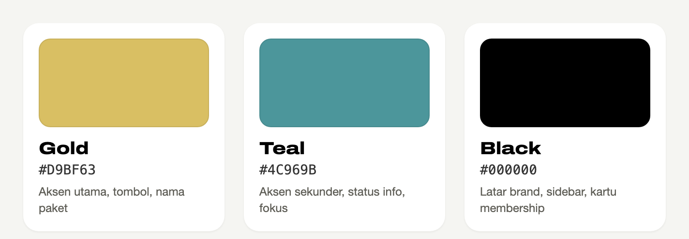
</p>

| Elemen | Penerapan |
|---|---|
| **Gold `#D9BF63`** | Tombol utama admin (teks hitam di atas emas), nama paket di kartu membership, menu aktif sidebar, warna utama tema gelap |
| **Teal `#4C969B`** | Tulisan "FITNESS CENTER", status *Terjadwal*/info, cincin fokus keyboard |
| **Black `#000000`** | Sidebar admin, monogram, kartu membership, tombol utama member di tema terang (teks emas) |
| Monogram "R" | Ikon aplikasi, favicon, logo di login dan sidebar ([`member-app/assets/brand/mark.png`](member-app/assets/brand/mark.png)) |
| Wordmark | "REVIRA" memakai Archivo (lebar 125%, tebal 800); "FITNESS CENTER" teal dengan jarak huruf lebar |

Catatan aksesibilitas warna: emas dan teal asli kontrasnya rendah sebagai teks di atas putih (sekitar 1,8:1 dan 3,4:1). Karena itu:
- Di tema terang, emas dipakai sebagai latar atau di atas hitam, dan teks sekunder memakai teal yang digelapkan (`#2F6E73`, sekitar 5,9:1).
- Di tema gelap, emas menjadi warna utama.
- Warna status (hijau, kuning, merah) tetap semantik supaya maknanya tidak tertukar.

> **Logo ilustrasi** (siluet atlet pada brand board) tidak tersedia sebagai file, sehingga tidak disertakan dan tidak digambar ulang. Monogram dan wordmark di aplikasi dibuat ulang dari font Archivo mengikuti brand board. Bila file logo asli tersedia, ganti aset di [`member-app/assets/brand/`](member-app/assets/brand) dan komponen [`BrandMark`](admin-web/src/components/brand/BrandMark.tsx)/[`BrandWordmark`](admin-web/src/components/brand/BrandWordmark.tsx).

---

## Tampilan aplikasi

Semua tangkapan layar diambil dari aplikasi yang berjalan dengan **API Laravel asli** dan data seeder (tanpa data mock), pada tanggal uji 20 November 2026.

### Admin Web

| | |
|---|---|
| 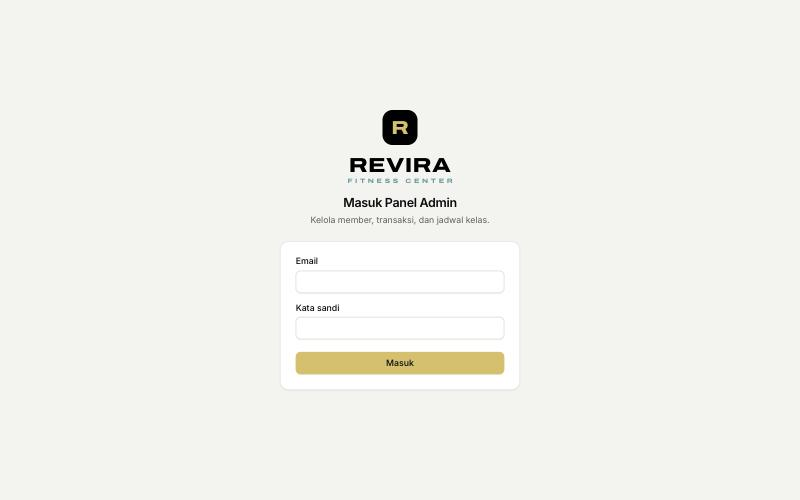 | 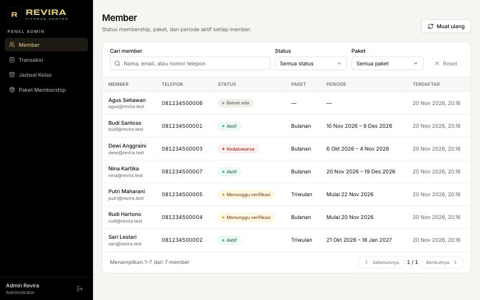 |
| **Login admin.** Logo dan wordmark brand, validasi per kolom, tombol terkunci selama proses. Akun non-admin ditolak dengan pesan jelas. | **Daftar member.** Status terkini (Aktif, Menunggu verifikasi, Akan aktif, Kedaluwarsa, Belum ada), paket, periode, telepon, dan tanggal daftar. Paginasi dari `meta` API. |
| 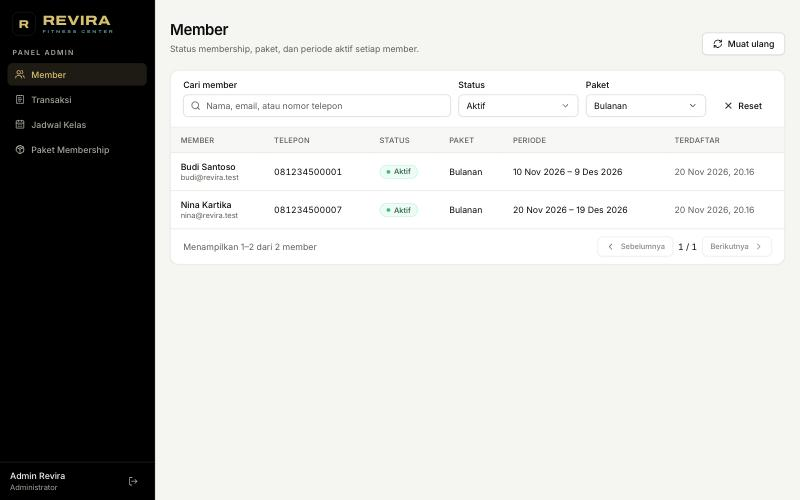 | 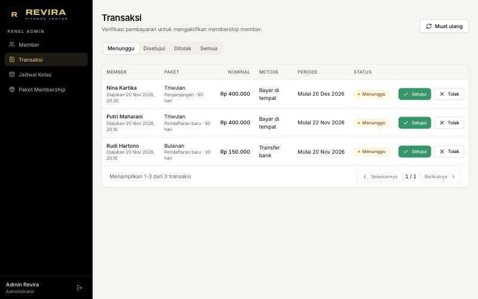 |
| **Filter member.** Status dan paket (`membership_plan_id`) disimpan di URL. Pencarian nama, email, atau telepon memakai debounce. | **Verifikasi transaksi.** Tab Menunggu/Disetujui/Ditolak/Semua, menampilkan nominal, metode bayar, jenis pengajuan (pendaftaran atau perpanjangan), dan rencana mulai. |
| 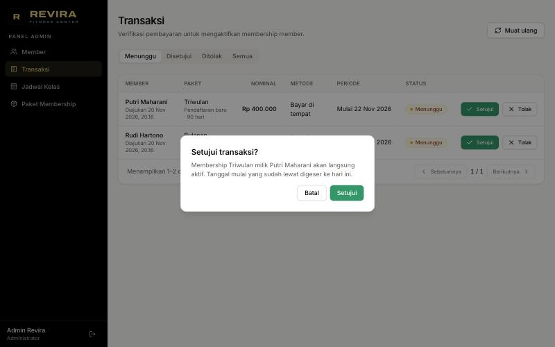 |  |
| **Konfirmasi setujui.** Dialog tidak bisa ditutup selama request berjalan; toast menampilkan periode hasil persetujuan. | **Tolak dengan alasan.** Alasan wajib (maks. 255 karakter) dan terlihat oleh member. |
| 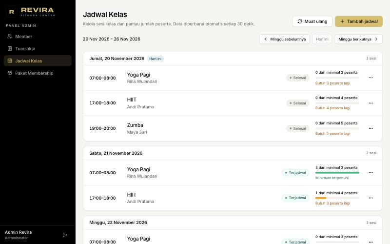 |  |
| **Jadwal kelas per minggu.** Status tampilan (Terjadwal/Berlangsung/Selesai/Dibatalkan) dan progres menuju minimum peserta. Dimuat ulang otomatis tiap 30 detik. | **Aksi per sesi.** Lihat peserta, ubah, tandai berlangsung/selesai, batalkan, hapus. Aksi yang tidak diizinkan otomatis nonaktif. |
| 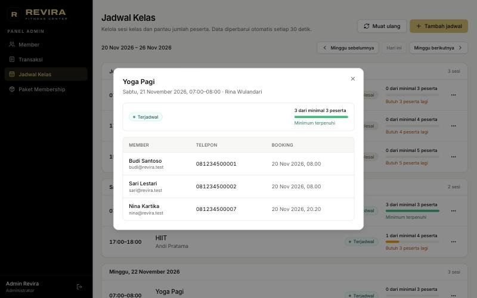 | 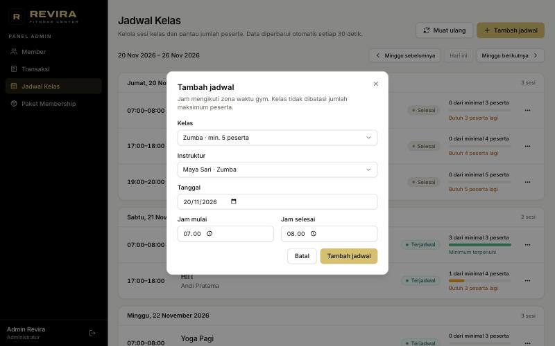 |
| **Daftar peserta.** Member yang membooking, telepon, dan waktu booking; counter sama dengan aplikasi member. | **Tambah/ubah jadwal.** Instruktur bawaan kelas terisi otomatis. API menolak jam yang sudah lewat dan instruktur yang bentrok. |
|  | 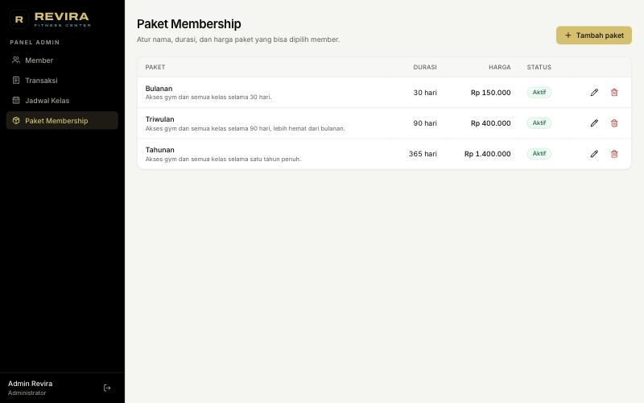 |
| **Batalkan sesi.** Alasan wajib dan ditampilkan ke member yang sudah booking. | **Paket membership.** CRUD paket (nama, durasi hari, harga rupiah, deskripsi, aktif/nonaktif). |
|  | 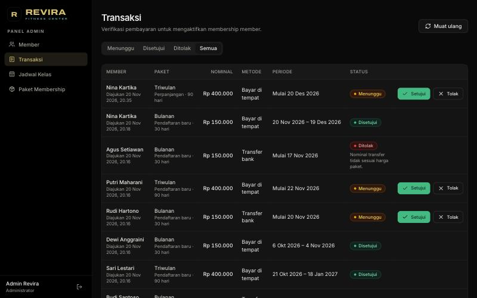 |
| **Form paket.** Paket yang sudah dipakai tidak bisa dihapus (409) dan cukup dinonaktifkan. | **Mode gelap.** Mengikuti preferensi sistem; tab *Semua* menampilkan transaksi disetujui, ditolak (beserta alasan), dan perpanjangan. |

### Member App

<table>
  <tr>
    <td width="25%"></td>
    <td width="25%"></td>
    <td width="25%">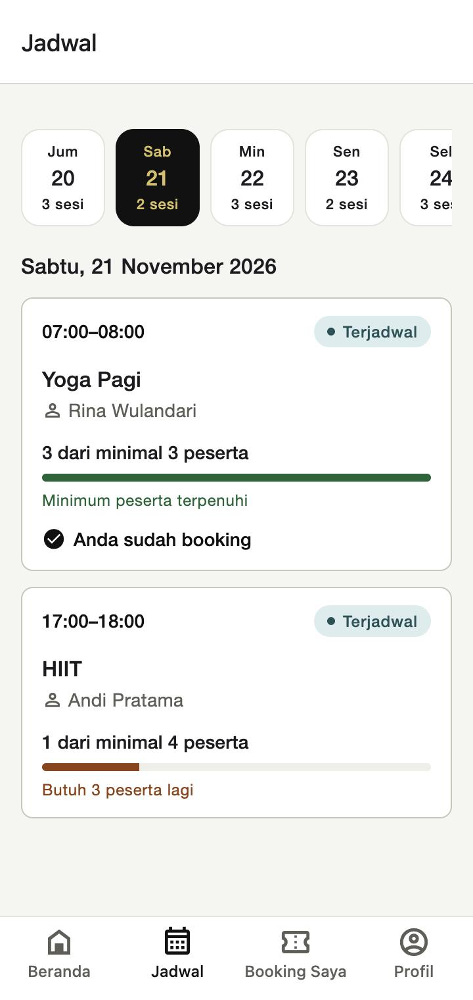</td>
    <td width="25%">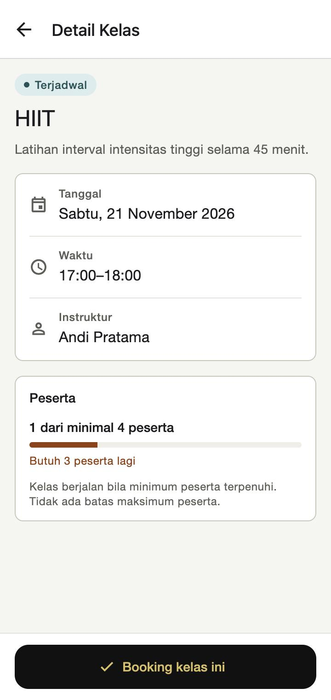</td>
  </tr>
  <tr>
    <td><b>Login.</b> Logo brand, tombol lihat/sembunyikan kata sandi, pesan error per kolom.</td>
    <td><b>Beranda.</b> Kartu membership hitam-emas (status, paket, periode, sisa hari) dan booking terdekat.</td>
    <td><b>Jadwal.</b> Pilih tanggal (7 hari), jumlah sesi per hari, status, counter peserta, tanda "Anda sudah booking".</td>
    <td><b>Detail kelas.</b> Tanggal, jam, instruktur, progres minimum peserta, dan tombol booking.</td>
  </tr>
  <tr>
    <td></td>
    <td>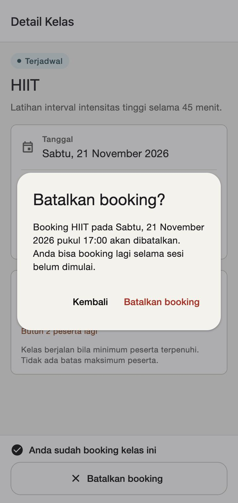</td>
    <td></td>
    <td></td>
  </tr>
  <tr>
    <td><b>Setelah booking.</b> Counter langsung bertambah dari respons API dan snackbar konfirmasi muncul.</td>
    <td><b>Batalkan booking.</b> Konfirmasi dulu; hanya bisa sebelum sesi dimulai.</td>
    <td><b>Booking saya.</b> Sesi yang dibooking dan belum selesai, urut waktu.</td>
    <td><b>Profil.</b> Data akun dan riwayat membership (disetujui, menunggu, ditolak beserta alasan).</td>
  </tr>
  <tr>
    <td>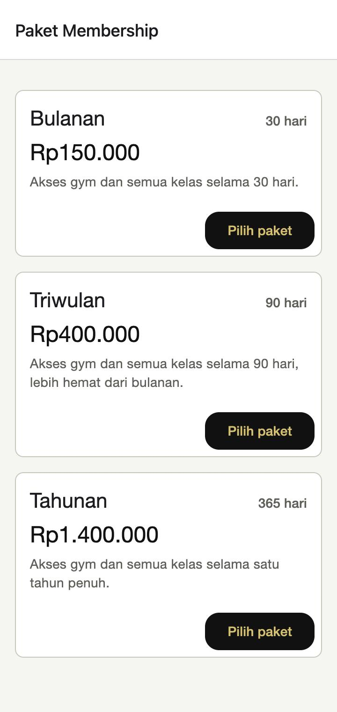</td>
    <td>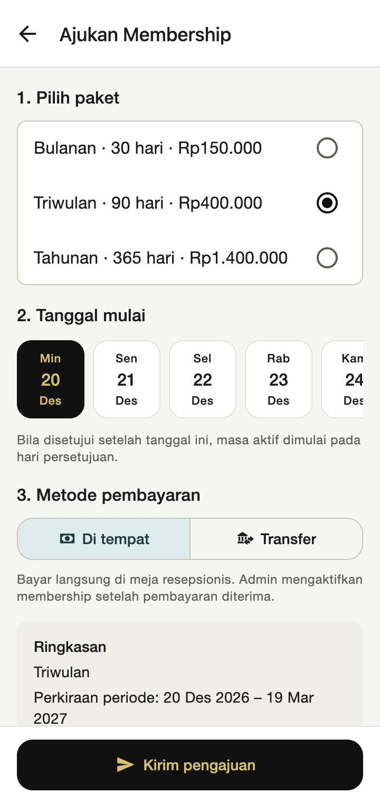</td>
    <td>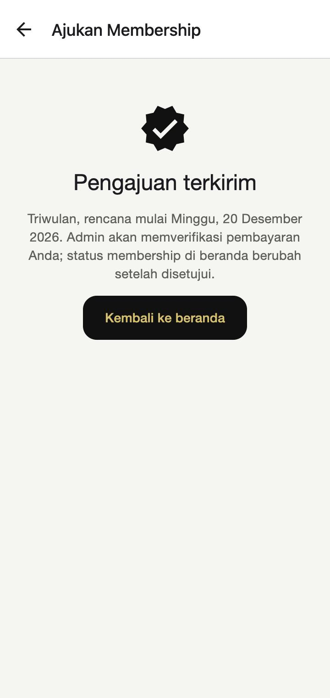</td>
    <td>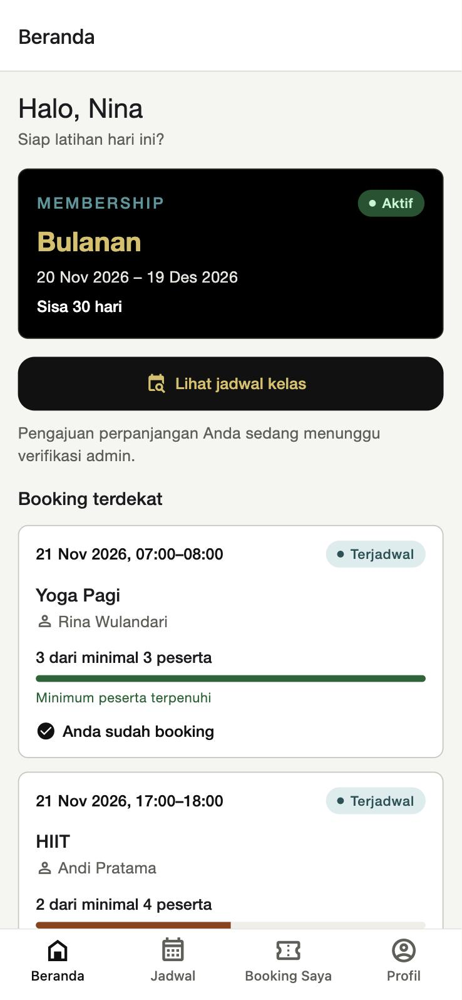</td>
  </tr>
  <tr>
    <td><b>Paket.</b> Daftar paket aktif dari endpoint publik.</td>
    <td><b>Ajukan membership.</b> Pilih paket, tanggal mulai (perpanjangan otomatis disarankan sehari setelah periode berjalan), metode bayar, ringkasan periode.</td>
    <td><b>Pengajuan terkirim.</b> Status beranda berubah setelah admin menyetujui.</td>
    <td><b>Lebar 412dp.</b> Perpanjangan yang menunggu verifikasi menyembunyikan tombol "Perpanjang".</td>
  </tr>
</table>

### Mode gelap dan responsif

<table>
  <tr>
    <td width="25%">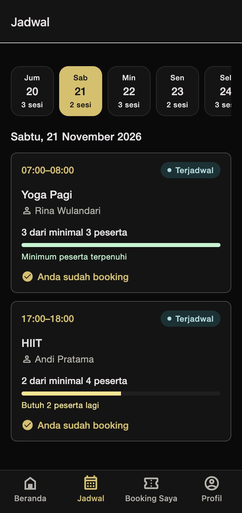</td>
    <td>
      <ul>
        <li><b>Member app:</b> tema terang/gelap otomatis mengikuti sistem. Tata letak diuji di lebar 360dp dan 412dp; konten dibatasi 560dp agar nyaman di tablet dan web. Target sentuh minimal 48dp.</li>
        <li><b>Admin web:</b> desktop-first dengan sidebar hitam; tabel bergulir di dalam kartunya sendiri bila layar sempit; mode gelap mengikuti sistem.</li>
        <li><b>Aksesibilitas:</b> label terhubung ke input (<code>htmlFor</code>/<code>aria-describedby</code>), pesan error dengan <code>role="alert"</code>, tautan "Lewati ke konten utama", fokus keyboard terlihat, dialog dari Radix (focus trap dan tombol Esc), label aksesibilitas pada kartu dan ikon di aplikasi member.</li>
      </ul>
    </td>
  </tr>
</table>

---

## Fitur

**Autentikasi**
- Login, `/me`, dan logout dengan bearer token Sanctum.
- Dua peran: admin dan member.
- Admin web menolak akun member, dan aplikasi member menolak akun admin.
- Token kedaluwarsa (401) otomatis mengakhiri sesi dan kembali ke login.

**Paket membership**
- Daftar paket aktif bersifat publik.
- CRUD khusus admin. Paket yang sudah dipakai tidak bisa dihapus, cukup dinonaktifkan.

**Membership**
- Member mengajukan dengan memilih paket, tanggal mulai, dan metode bayar (`transfer`/`on_the_spot`).
- Admin menyetujui atau menolak transaksinya.
- Periode: `end_date = start_date + durasi − 1` (inklusif). Tanggal mulai yang sudah lewat saat disetujui digeser ke hari persetujuan.
- Status terkini: `active` > `pending` > `upcoming` > `expired` > `none`.

**Daftar member (admin)**
- Status, paket, dan periode diambil dari membership penentu, plus nomor telepon.
- Filter status, filter `membership_plan_id`, dan pencarian.
- Paginasi 15 baris dengan `meta`.

**Jadwal kelas (admin)**
- Daftar per rentang tanggal, maksimal 31 hari.
- Tambah dan ubah, dengan cek jam lewat dan bentrok instruktur.
- Ubah status (berlangsung/selesai/batal dengan alasan).
- Hapus sesi yang belum pernah dibooking.
- Daftar peserta.

**Booking (member)**
- Jadwal 7 hari, detail sesi, booking dan pembatalan, Booking Saya.
- Counter peserta dan status tampilan: terjadwal, berlangsung, selesai, dibatalkan.

**Konsistensi data**
- Tombol submit terkunci selama request.
- Request lama dibatalkan (`AbortController`) saat filter, halaman, atau token berubah.
- Data hanya diambil setelah sesi siap.
- Data dimuat ulang saat layar difokuskan.

## Aturan bisnis

| Aturan | Hasil |
|---|---|
| Booking hanya untuk sesi berstatus `scheduled` yang belum dimulai | Selain itu **422** (`errors.booking`) |
| Member harus aktif pada **tanggal sesi** (`active` dan `start_date ≤ tanggal ≤ end_date`) | Bila tidak, **422** "Membership Anda tidak aktif pada tanggal sesi ini." |
| Booking ganda pada sesi yang sama | **409** "Anda sudah membooking sesi ini." |
| Kapasitas kelas | Hanya `min_participants`, **tanpa batas maksimum** (keputusan referensi). Karena itu status "penuh" tidak ada |
| Pembatalan booking | Hanya sebelum sesi dimulai; booking bisa diulang (baris lama diaktifkan kembali) |
| Pengajuan membership | Ditolak 422 bila masih ada pengajuan *pending* atau periode bertabrakan dengan membership aktif |
| Persetujuan transaksi | 409 bila sudah diproses atau periode bertabrakan dengan membership aktif lain |
| Validasi gagal / tanpa token / peran salah | **422** / **401** / **403** |
| Login dan pengajuan | Dibatasi 5 percobaan/menit (login) dan 10/menit (pengajuan) |

## Arsitektur dan struktur folder

```text
.
├── api/                         Laravel 13 (REST /api/v1)
│   ├── app/Enums                Status sebagai backed enum
│   ├── app/Http/Controllers     Controller tipis (tanpa logika bisnis)
│   ├── app/Http/Requests        Form Request untuk semua validasi
│   ├── app/Http/Resources       API Resource untuk semua respons
│   ├── app/Http/Middleware      EnsureRole (role:admin / role:member)
│   ├── app/Services             Logika bisnis: booking, membership, transaksi, jadwal, member
│   ├── app/Casts/DateOnly.php   Kolom tanggal selalu Y-m-d
│   ├── database/                Migrasi, factory, seeder data fiktif
│   ├── docs/openapi.yaml        Kontrak API (OpenAPI 3.1)
│   ├── lang/id                  Pesan validasi bahasa Indonesia
│   └── tests/                   PHPUnit (Feature + Unit)
├── admin-web/                   React + Vite + TypeScript strict
│   └── src/
│       ├── api/                 Fungsi endpoint bertipe
│       ├── auth/                AuthProvider, guard RequireAdmin
│       ├── components/          ui/ (Radix + Tailwind), brand/, layout/
│       ├── domain/              Normalisasi status, progres peserta (dites)
│       ├── features/            members, transactions, schedules, plans, auth
│       ├── hooks/               useApiQuery (abort + reload), useMutation (kunci submit)
│       └── lib/                 http client, format, config, token storage
├── member-app/                  Expo + expo-router + TypeScript strict
│   ├── assets/                  Ikon, favicon, monogram, wordmark
│   └── src/
│       ├── app/                 Rute: login, (tabs)/…, schedules/[id], plans, apply
│       ├── api/  auth/  hooks/  lib/
│       ├── components/          Kartu, chip status, counter peserta, state views
│       ├── domain/              Aturan booking, normalisasi status (dites)
│       └── theme.ts             Tema Material 3 dengan palet brand
└── docs/
    ├── SETUP.md                 Panduan menjalankan, variabel lingkungan, skenario E2E
    ├── screenshots/             Tangkapan layar README
    └── brand/                   Palet warna
```

Prinsip yang dipakai:
- Laravel mengikuti PSR-12 (dicek Pint): Form Request, API Resource, service class, dan middleware peran.
- Frontend memakai TypeScript strict (tanpa `any`), komponen kecil dengan satu tanggung jawab, dan logika dipisah ke hooks/domain.
- Nama kode dalam bahasa Inggris; teks antarmuka dalam bahasa Indonesia.

## Spesifikasi teknis

| Komponen | Versi (terpasang) |
|---|---|
| PHP / Composer | 8.4 / 2.9 |
| Laravel framework / Sanctum | 13.43 / 4.x |
| Database lokal | SQLite (`pdo_sqlite`) |
| Node.js / npm | 24 LTS / 11 |
| React (admin) / Vite / TypeScript | 19.3.1 / 8.3.8 / 6.0.3 |
| Tailwind CSS / Radix UI / React Router | 4.3.5 / 1.8.1 (`radix-ui`) / 8.5.2 |
| Ikon / notifikasi / font | lucide-react 1.77 / sonner 2.0 / Inter & Archivo (Fontsource) |
| Expo SDK / React Native / React (member) | 58.0.26 / 0.88.1 / 19.3.0 |
| expo-router / React Native Paper | 58.0.32 / 5.15.5 |
| Pengujian | PHPUnit 12, Vitest 5.1, Testing Library |
| Zona waktu bisnis | `Asia/Makassar` (WITA), dapat diubah lewat `APP_TIMEZONE` |
| Format respons | `data` (+ `links`/`meta` untuk paginasi); tanggal `YYYY-MM-DD`; jam `HH:MM`; waktu ISO 8601 dengan offset; uang integer rupiah |

## Skema database

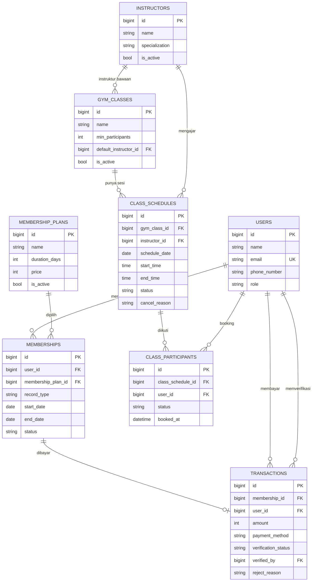

Catatan desain skema:
- **Riwayat, bukan overwrite.** Setiap pengajuan atau perpanjangan adalah baris baru di `memberships`.
- **Status membership:** `pending`, `active`, `expired`, atau `rejected`. Status `upcoming` dan `none` diturunkan saat dibaca.
- **Booking:** `class_participants` memiliki UNIQUE `(class_schedule_id, user_id)`. Pembatalan mengubah status, tidak menghapus baris.
- **Jumlah peserta** dihitung langsung dari booking yang tidak dibatalkan, tanpa kolom counter yang bisa tidak sinkron.
- **Tidak ada kolom kapasitas maksimum** di tabel kelas.

## Kontrak API

Dokumen lengkap: [`api/docs/openapi.yaml`](api/docs/openapi.yaml) (OpenAPI 3.1, 29 operasi).

| Metode | Endpoint | Akses | Keterangan |
|---|---|---|---|
| GET | `/health` | Publik | Cek server |
| GET | `/membership-plans` | Publik | Paket aktif |
| POST | `/login` | Publik | Token bearer (5/menit) |
| POST | `/logout` | Login | Cabut token (204) |
| GET | `/me` | Login | Profil + ringkasan membership (`status`, `is_active`, `has_pending_application`, paket, periode) |
| GET, POST | `/member/memberships` | Member | Riwayat / ajukan (201) |
| GET | `/member/class-schedules?from&to` | Member | Jadwal + `is_booked` |
| GET | `/member/class-schedules/{id}` | Member | Detail sesi |
| POST, DELETE | `/member/class-schedules/{id}/booking` | Member | Booking / batal (mengembalikan jadwal terbaru) |
| GET | `/member/bookings` | Member | Booking yang belum selesai |
| GET, POST, GET, PUT, DELETE | `/admin/membership-plans[/{id}]` | Admin | CRUD paket |
| GET | `/admin/members?status&membership_plan_id&search&page` | Admin | Daftar member + `meta` paginasi |
| GET | `/admin/transactions?status&page` | Admin | Daftar transaksi |
| POST | `/admin/transactions/{id}/approve` · `/reject` | Admin | Setujui / tolak (alasan wajib) |
| GET, POST, GET, PUT, DELETE | `/admin/class-schedules[/{id}]` | Admin | Kelola jadwal |
| PATCH | `/admin/class-schedules/{id}/status` | Admin | Ubah status sesi |
| GET | `/admin/classes`, `/admin/instructors` | Admin | Pilihan form jadwal |

Contoh respons error:

```jsonc
// 422
{ "message": "Membership Anda tidak aktif pada tanggal sesi ini.", "errors": { "booking": ["Membership Anda tidak aktif pada tanggal sesi ini."] } }
// 409
{ "message": "Anda sudah membooking sesi ini." }
// 401
{ "message": "Unauthenticated." }
```

## Instalasi dan menjalankan

Panduan lengkap beserta daftar variabel lingkungan dan skenario uji ada di **[docs/SETUP.md](docs/SETUP.md)**. Ringkasnya:

**1. API**

```bash
cd api
composer install
```

Buat `api/.env` (minimal `APP_ENV`, `APP_KEY`, `SEED_PASSWORD`; lihat SETUP.md), lalu:

```bash
php artisan key:generate
touch database/database.sqlite
php artisan migrate --seed
php artisan serve
```

**2. Admin web**

```bash
cd admin-web
npm install
```

Buat `admin-web/.env.local` berisi `VITE_API_URL`, lalu:

```bash
npm run dev
```

**3. Member app**

```bash
cd member-app
npm install
```

Buat `member-app/.env` berisi `EXPO_PUBLIC_API_URL`, lalu:

```bash
npx expo start
```

Pindai QR code dengan Expo Go (HP dan komputer satu jaringan; isi URL dengan IP komputer), atau tekan `w` untuk versi web.

**Variabel lingkungan (nama saja):**
- API: `APP_NAME`, `APP_ENV`, `APP_KEY`, `APP_DEBUG`, `APP_URL`, `APP_TIMEZONE`, `APP_LOCALE`, `DB_CONNECTION`, `DB_DATABASE`, `SEED_PASSWORD`, `CACHE_STORE`, `SESSION_DRIVER`, `QUEUE_CONNECTION`.
- Admin web: `VITE_API_URL`.
- Member app: `EXPO_PUBLIC_API_URL`.

Akun seeder: `admin@revira.test` serta `budi`, `sari`, `dewi`, `rudi`, `putri`, `agus`, dan `nina` `@revira.test`. Kata sandinya adalah nilai `SEED_PASSWORD` yang Anda isi sendiri; tidak ada kata sandi yang ditulis di kode atau dokumentasi.

## Pengujian

```bash
cd api && php artisan test && ./vendor/bin/pint --test
cd admin-web && npm run typecheck && npm run lint && npm test && npm run build
cd member-app && npm run typecheck && npm run lint && npm test
```

| Bagian | Cakupan | Hasil terakhir |
|---|---|---|
| API (PHPUnit) | Auth (login/me/logout/401/403), paket (CRUD, 404, 409), pengajuan (201, pending ganda, overlap, validasi 422), approval (periode inklusif, geser tanggal lampau, 409), booking (200, 401, 404, 409, 422 untuk sesi batal/dimulai/membership tidak aktif, batal dan booking ulang), daftar member (status, filter paket, pencarian, paginasi), jadwal admin, alur end-to-end, seeder, unit resolver status, dan status tampilan sesi | **82 tes lulus (363 assertion)**, Pint lulus |
| Admin web (Vitest) | Normalisasi status membership/jadwal/transaksi, aksi jadwal, progres peserta, klien HTTP dan error, format, `useMutation` (kunci submit ganda), `useApiQuery` (menunggu auth, membatalkan request lama, reload, 401) | **40 tes lulus**; `tsc` strict, ESLint (0 peringatan), dan build produksi lulus |
| Member app (Vitest) | Aturan booking (aktif pada tanggal sesi, perpanjangan, sesi batal/dimulai, batal booking), normalisasi status, saran tanggal mulai, format tanggal/rupiah, helper HTTP | **31 tes lulus**; `tsc` strict dan ESLint (termasuk aturan React Compiler) lulus |

## Hasil analisis

### 1. Analisis repositori referensi

Referensi `Revira-gym-project-v2` dipelajari, tanpa menyalin kode: README, ERD, kontrak OpenAPI, migrasi, model, service, seeder, tes, dan layar admin/member. Yang diadopsi sebagai aturan bisnis:
- Satu tabel `users` dengan peran.
- Pemisahan `memberships` (periode) dan `transactions` (pembayaran), dengan riwayat sebagai baris baru.
- Tidak ada kapasitas maksimum kelas.
- Definisi "member aktif pada tanggal sesi".
- Prioritas status member.
- Kunci baris (`lockForUpdate`) untuk booking dan approval.
- Konvensi format respons (tanggal, jam, uang).

Yang sengaja **tidak** dibawa karena di luar lingkup permintaan atau terkait deploy:
- Gateway WhatsApp (Fonnte).
- Upload bukti transfer.
- Jam operasional.
- CRUD instruktur dan kelas (cukup data seeder dan endpoint baca).
- Registrasi mandiri.
- Docker/Railway.
- Workflow CI.
- MySQL (diganti SQLite lokal).

### 2. Keputusan desain

| Keputusan | Alasan |
|---|---|
| `end_date` inklusif (`start + durasi − 1`) | Mengikuti referensi; paket 30 hari mulai 20 Nov berakhir 19 Des |
| Status "penuh" dihapus | Tanpa kapasitas maksimum, API tidak pernah menghasilkannya; badge "penuh" hanya akan menjadi kode mati |
| Tanpa upload bukti transfer | Tidak diminta; metode bayar tetap dicatat dan admin memverifikasi manual |
| Status `upcoming` ditambahkan | Membership yang disetujui tetapi belum mulai tidak salah tampil sebagai "none" atau "expired" |
| Membership penentu = id terbesar per kategori | Paket di daftar member dan filter `membership_plan_id` dijamin konsisten (subquery yang sama dengan resolver PHP) |
| Cast `DateOnly` | Cast `date` bawaan menyimpan `Y-m-d 00:00:00` di SQLite sehingga pencocokan tanggal persis gagal |
| `has_pending_application` di `/me` | Perpanjangan yang menunggu verifikasi tetap terlihat walau status terkini `active` |
| Status tampilan dihitung dari jam | Admin tidak selalu mengubah status tepat waktu; sesi yang lewat jam mulai/selesai tetap tampil benar |

### 3. Riset framework UI

**Admin web.** Perbandingan komunitas 2026 paling konsisten merekomendasikan shadcn/ui di atas Radix untuk aksesibilitas (WAI-ARIA) dan kontrol penuh atas kode, dan stack ini cocok dengan Vite + Tailwind. MUI dan Mantine lebih berat dan memakai sistem styling sendiri. Radix dipilih alih-alih Base UI karena lebih matang (konservatif).

**Member app.** NativeWind stabil (4.2.7) masih untuk Tailwind v3 dan baru terverifikasi sampai Expo SDK 57; v5 untuk Tailwind v4 masih RC. Untuk Expo Go SDK 58 itu berisiko. React Native Paper (Material 3) dipilih karena matang, peer dependency longgar, berjalan di Expo Go, dan aksesibel.

Sumber:
- [shadcn/ui vs MUI vs Ant Design](https://adminlte.io/blog/shadcn-ui-vs-mui-vs-ant-design/)
- [Shadcn Alternatives 2026](https://designrevision.com/alternatives/shadcn)
- [Dokumentasi shadcn/ui untuk Vite](https://ui.shadcn.com/docs/installation/vite)
- [NativeWind v5 migration guide](https://www.nativewind.dev/v5/guides/migrate-from-v4)
- [LogRocket: React Native UI libraries](https://blog.logrocket.com/best-react-native-ui-component-libraries/)

### 4. Temuan uji end-to-end dan perbaikannya

Uji dijalankan pada API asli (`php artisan serve` + SQLite), admin web (Vite), dan member app versi web (Expo), di lebar 1280px, 360dp, dan 412dp, dalam mode terang dan gelap. Alur ajukan → setujui → daftar member → booking → counter → peserta di admin berhasil. Masalah yang ditemukan lalu diperbaiki:

| Temuan | Perbaikan |
|---|---|
| Request tanpa token **dan** tanpa header `Accept: application/json` menghasilkan 500 ("Route [login] not defined") | Tamu tidak lagi diarahkan ke halaman login (`redirectGuestsTo`); kini selalu 401 JSON, dengan tes regresi |
| Label tab bar member terpotong (label 12px di tab bar 48px) | Tinggi tab bar mengikuti safe-area inset |
| `ProgressBar` Paper di web memakai `height: 100%` sehingga teks "Butuh N peserta lagi" keluar dari kartu | Progress bar dibungkus wadah setinggi 6px |
| Banner "membership tidak aktif" masih muncul setelah admin menyetujui | Profil dimuat ulang setiap layar Jadwal/Paket difokuskan |
| Snackbar menutupi tombol "Batalkan booking" | Snackbar diposisikan di atas footer aksi |
| Field login member tanpa nama aksesibel di web | `accessibilityLabel` ditambahkan |
| Warna elevation bawaan MD3 bernuansa ungu (dialog) | Diganti netral sesuai palet brand |
| Tombol "Perpanjang" tetap muncul saat perpanjangan masih pending | `/me` mengirim `has_pending_application`, dan aplikasi menyembunyikan tombol |
| Tabel transaksi admin melebar melewati layar | Kolom grid `minmax(0,1fr)` dan padding sel lebih rapat |

Kasus negatif pada API live:

| Kasus | Hasil |
|---|---|
| Booking ganda | 409 |
| Booking sesi dibatalkan | 422 |
| Member tanpa membership aktif | 422 |
| Tanpa token | 401 |
| Pengajuan tanggal lampau + metode salah | 422, dua error per kolom |
| Member ke endpoint admin | 403 |

### 5. Keamanan dan privasi

- Tidak ada kredensial, token, atau file `.env` di repositori.
- Kata sandi seeder dibaca dari `SEED_PASSWORD`. Seeder menolak berjalan bila nilainya kosong, dan menolak berjalan di `production`.
- Kata sandi di-hash (bcrypt).
- Token bearer Sanctum dicabut saat logout.
- Peran dicek oleh middleware `role` setelah `auth:sanctum`.
- Login dibatasi 5/menit dan pengajuan 10/menit.
- Persetujuan transaksi dan booking memakai transaksi database dengan kunci baris untuk mencegah race condition di server.
- Di klien, tombol dikunci selama request dan request lama dibatalkan.
- Token admin disimpan di `localStorage`. Token member disimpan di `expo-secure-store` (native) dan `localStorage` (web).

## Keterbatasan dan rekomendasi

**Belum diverifikasi**
- Aplikasi member belum diuji di HP fisik lewat Expo Go maupun build native Android/iOS. Pengujian visual dilakukan pada versi web Expo dengan emulasi 360dp dan 412dp.
- `npx @redocly/cli lint` tidak dijalankan karena izin mengunduh alat ditolak saat pengembangan. Sebagai gantinya, skrip lokal memastikan semua `$ref` OpenAPI valid dan 29 operasi cocok dengan 29 route Laravel.

**Keterbatasan fungsional**
- Logo ilustrasi brand belum disertakan karena filenya tidak tersedia.
- Pemeriksaan "sesi sudah dimulai" di aplikasi member memakai jam perangkat. API tetap menjadi penentu akhir dengan zona `APP_TIMEZONE`.
- Status `expired` tersimpan tidak diubah oleh job terjadwal. Status terkini dihitung dari tanggal saat dibaca, sehingga hasilnya tetap benar.

**Rekomendasi sebelum produksi**
- Ganti SQLite dengan MySQL/PostgreSQL.
- Batasi CORS ke domain frontend.
- Atur masa berlaku token Sanctum.
- Tambahkan upload bukti transfer dan notifikasi WhatsApp bila dibutuhkan.
- Siapkan build EAS untuk Android/iOS.
