<p align="center">
  
</p>
<p align="center">
  <picture>
    <source media="(prefers-color-scheme: dark)" srcset="member-app/assets/brand/wordmark-dark.png" />
    
  </picture>
</p>

# Revira Fitness Center: Sistem Membership & Booking Kelas

Monorepo aplikasi gym Revira Fitness Center, terdiri dari tiga bagian yang saling terhubung:

| Bagian | Teknologi | Untuk siapa |
|---|---|---|
| [`api/`](api) | Laravel 13, Sanctum (bearer token), SQLite, OpenAPI | Backend REST `/api/v1` |
| [`admin-web/`](admin-web) | React 19, Vite 8, TypeScript, Tailwind CSS 4, komponen gaya shadcn/ui di atas Radix UI | Admin gym (desktop) |
| [`member-app/`](member-app) | Expo SDK 58, React Native 0.88, expo-router, React Native Paper (Material 3) | Member gym (Expo Go, Android, iOS, web) |

Member mengajukan membership dan membooking kelas lewat aplikasi member; admin memverifikasi pembayaran, mengelola paket dan jadwal, serta memantau aktivitas lewat panel admin. Semua data berasal dari API Laravel, tanpa data mock.

Alur utama yang sudah diuji ujung ke ujung:
1. Member memilih paket (durasi dan harga terlihat jelas) lalu mengajukan membership.
2. Admin menyetujui; aksinya tercatat di Log Aktivitas.
3. Periode aktif muncul di daftar member.
4. Member membooking kelas.
5. Counter peserta bertambah dan admin melihat pesertanya.

Harga membership saat ini (detail di [Harga membership](#harga-membership)):

| Paket | Durasi | Harga |
|---|---|---|
| Per Datang | 1 hari | **Rp75.000** |
| 1 Bulan | 30 hari | **Rp500.000** |
| 3 Bulan | 90 hari | **Rp1.050.000** |
| 1 Tahun | 365 hari | **Rp3.075.000** |

## Daftar isi

- [Mulai cepat](#mulai-cepat)
- [Fitur](#fitur)
- [Tampilan aplikasi](#tampilan-aplikasi)
  - [Admin Web](#admin-web)
  - [Member App](#member-app)
  - [Mode gelap dan responsif](#mode-gelap-dan-responsif)
- [Arsitektur dan struktur folder](#arsitektur-dan-struktur-folder)
- [Teknologi dan prasyarat](#teknologi-dan-prasyarat)
- [Instalasi dan menjalankan](#instalasi-dan-menjalankan)
- [Perintah pengembangan](#perintah-pengembangan)
- [Dokumentasi API](#dokumentasi-api)
- [Harga membership](#harga-membership)
- [Keamanan](#keamanan)
- [Aturan bisnis](#aturan-bisnis)
- [Skema database](#skema-database)
- [UI/UX dan animasi](#uiux-dan-animasi)
- [Identitas visual](#identitas-visual)
- [Troubleshooting](#troubleshooting)
- [Hasil analisis](#hasil-analisis)
- [Keterbatasan dan tindak lanjut](#keterbatasan-dan-tindak-lanjut)

---

## Mulai cepat

Butuh PHP ≥ 8.3, Composer 2, dan Node.js 22/24. Langkah lengkap, daftar variabel lingkungan, dan skenario uji ada di **[docs/SETUP.md](docs/SETUP.md)**.

```bash
# 1. API (http://127.0.0.1:8000)
cd api && composer install
# buat api/.env (APP_ENV=local, APP_KEY, SEED_PASSWORD, dll. lihat SETUP.md)
php artisan key:generate && touch database/database.sqlite && php artisan migrate --seed
php artisan serve
```

```bash
# 2. Admin web (http://localhost:5173), isi admin-web/.env.local dengan VITE_API_URL
cd admin-web && npm install && npm run dev
```

```bash
# 3. Member app (Expo Go atau web di http://localhost:8081), isi member-app/.env dengan EXPO_PUBLIC_API_URL
cd member-app && npm install && npx expo start
```

## Fitur

**Member (aplikasi member)**
- Login dan logout; akun admin ditolak di aplikasi ini.
- Beranda: kartu membership (status, paket, periode, sisa hari) dan booking terdekat.
- Lihat paket beserta durasi dan harga, lalu ajukan membership: pilih paket, tanggal mulai, dan metode bayar (`transfer`/`on_the_spot`), dengan ringkasan total bayar.
- Jadwal kelas 7 hari, detail sesi dengan counter peserta, booking dan pembatalan sebelum sesi dimulai, serta daftar Booking Saya.
- Profil dan riwayat membership (disetujui, menunggu, ditolak beserta alasan).

**Admin (panel admin web)**
- Login dan logout; akun member ditolak di panel ini.
- Daftar member: status terkini, paket, periode, telepon; filter status, filter `membership_plan_id`, pencarian, paginasi 15 baris.
- Verifikasi transaksi: setujui (periode inklusif `start + durasi − 1`, tanggal lampau digeser ke hari persetujuan) atau tolak dengan alasan.
- Paket membership: CRUD, nama unik, paket yang sudah dipakai hanya bisa dinonaktifkan.
- Jadwal kelas: tambah/ubah (cek jam lewat dan bentrok instruktur), ubah status, batal dengan alasan, hapus sesi tanpa booking, daftar peserta.
- Log Aktivitas: jejak aksi admin (paket, transaksi, jadwal, login admin) dengan filter jenis aksi.

**Umum**
- Dua peran (admin dan member) dengan token bearer Sanctum yang punya masa berlaku (admin 8 jam, member 30 hari); token kedaluwarsa mengakhiri sesi dan kembali ke login.
- Status membership terkini: `active` > `pending` > `upcoming` > `expired` > `none`.
- Konsistensi data di klien: tombol submit terkunci selama request, request lama dibatalkan (`AbortController`), data diambil setelah sesi siap dan dimuat ulang saat layar difokuskan.
- Bahasa antarmuka Indonesia, tema terang/gelap mengikuti sistem.

## Tampilan aplikasi

Semua tangkapan layar diambil dari aplikasi yang berjalan dengan **API Laravel asli** dan data seeder (tanpa data mock), pada tanggal uji 20 November 2026.

### Admin Web

| | |
|---|---|
|  |  |
| **Login admin.** Logo dan wordmark brand, validasi per kolom, tombol terkunci selama proses. Akun non-admin ditolak dengan pesan jelas. | **Daftar member.** Status terkini (Aktif, Menunggu verifikasi, Akan aktif, Kedaluwarsa, Belum ada), paket, periode, telepon, dan tanggal daftar. Paginasi dari `meta` API. |
|  |  |
| **Filter member.** Status dan paket (`membership_plan_id`) disimpan di URL. Pencarian nama, email, atau telepon memakai debounce. | **Verifikasi transaksi.** Tab Menunggu/Disetujui/Ditolak/Semua, menampilkan nominal, metode bayar, jenis pengajuan (pendaftaran atau perpanjangan), dan rencana mulai. Pengajuan lama yang nominalnya berbeda dari harga paket saat ini diberi tanda *Harga paket kini …*. |
|  | 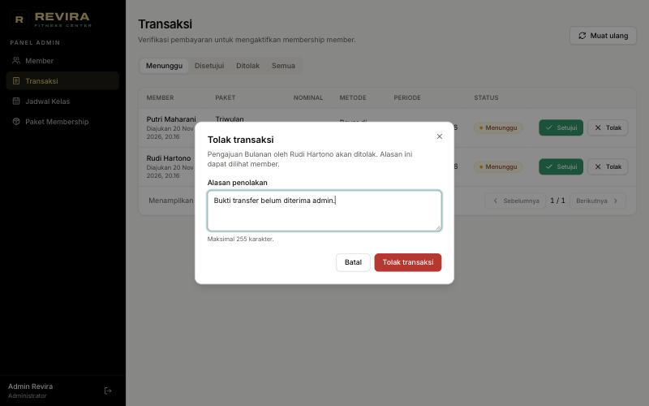 |
| **Konfirmasi setujui.** Dialog muncul dengan animasi singkat dan tidak bisa ditutup selama request berjalan; toast menampilkan periode hasil persetujuan. | **Tolak dengan alasan.** Alasan wajib (maks. 255 karakter, tag HTML dibuang di server) dan terlihat oleh member. |
|  | 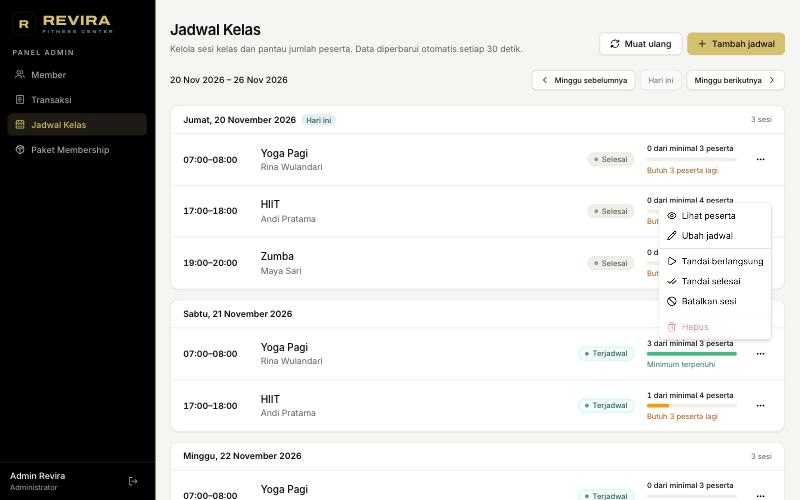 |
| **Jadwal kelas per minggu.** Status tampilan (Terjadwal/Berlangsung/Selesai/Dibatalkan) dan progres menuju minimum peserta. Dimuat ulang otomatis tiap 30 detik. | **Aksi per sesi.** Lihat peserta, ubah, tandai berlangsung/selesai, batalkan, hapus. Aksi yang tidak diizinkan otomatis nonaktif. |
|  |  |
| **Daftar peserta.** Member yang membooking, telepon, dan waktu booking; counter sama dengan aplikasi member. | **Tambah/ubah jadwal.** Instruktur bawaan kelas terisi otomatis. API menolak jam yang sudah lewat dan instruktur yang bentrok. |
| 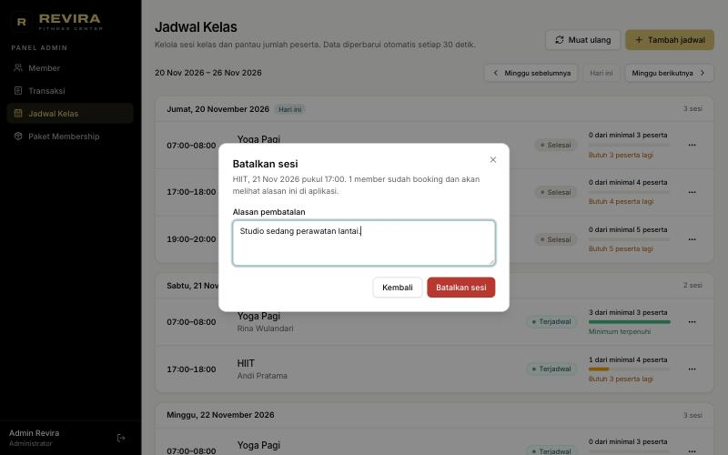 |  |
| **Batalkan sesi.** Alasan wajib dan ditampilkan ke member yang sudah booking. | **Paket membership.** Per Datang Rp75.000, 1 Bulan Rp500.000, 3 Bulan Rp1.050.000, 1 Tahun Rp3.075.000, dibaca dari API. CRUD paket (nama unik, durasi hari, harga rupiah, deskripsi, aktif/nonaktif). |
| 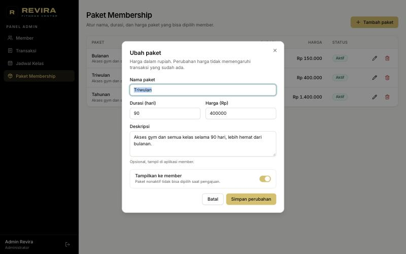 | 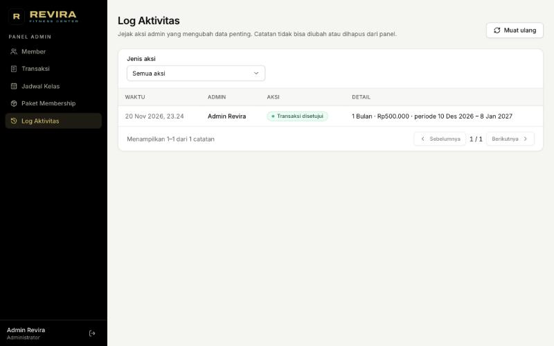 |
| **Form paket.** Pratinjau "Tampil sebagai Rp500.000" di bawah kolom harga. Paket yang sudah dipakai tidak bisa dihapus (409) dan cukup dinonaktifkan. | **Log aktivitas.** Jejak aksi admin (setujui/tolak transaksi, ubah harga paket, ubah jadwal, login admin) dengan filter jenis aksi. Catatan tidak bisa diubah atau dihapus. |
|  | |
| **Mode gelap.** Mengikuti preferensi sistem; tab *Semua* menampilkan transaksi disetujui, ditolak (beserta alasan), dan perpanjangan. | |

### Member App

<table>
  <tr>
    <td width="25%">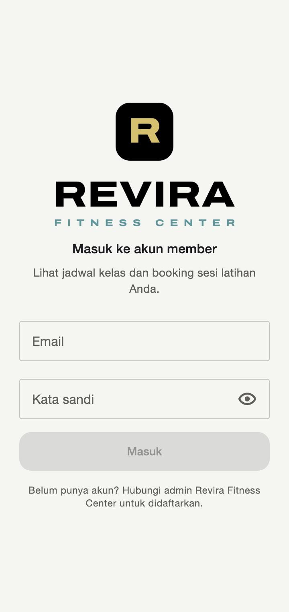</td>
    <td width="25%">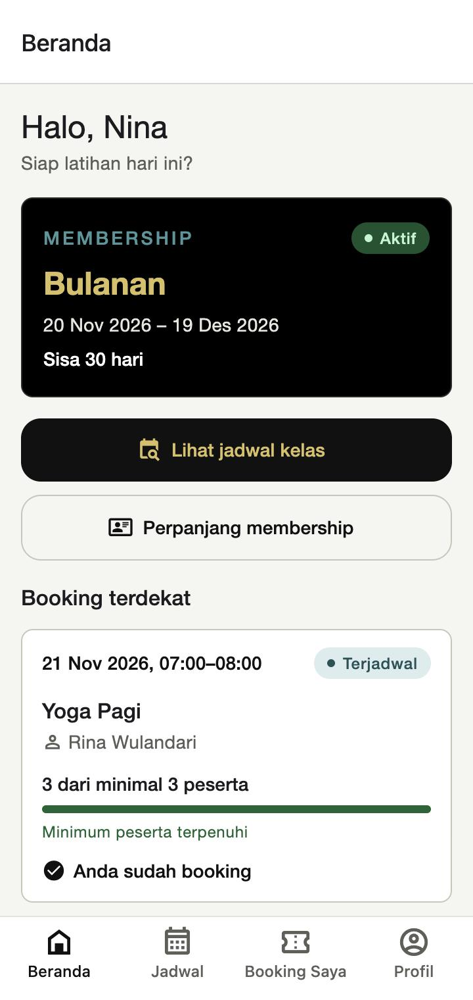</td>
    <td width="25%"></td>
    <td width="25%"></td>
  </tr>
  <tr>
    <td><b>Login.</b> Logo brand, tombol lihat/sembunyikan kata sandi, pesan error per kolom.</td>
    <td><b>Beranda.</b> Kartu membership hitam-emas (status, paket, periode, sisa hari) dan booking terdekat.</td>
    <td><b>Jadwal.</b> Pilih tanggal (7 hari), jumlah sesi per hari, status, counter peserta, tanda "Anda sudah booking".</td>
    <td><b>Detail kelas.</b> Tanggal, jam, instruktur, progres minimum peserta, dan tombol booking.</td>
  </tr>
  <tr>
    <td>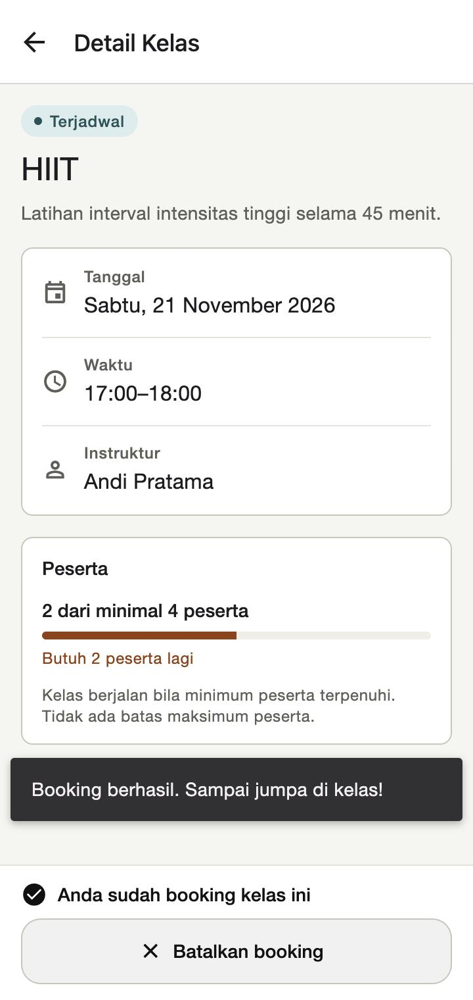</td>
    <td></td>
    <td>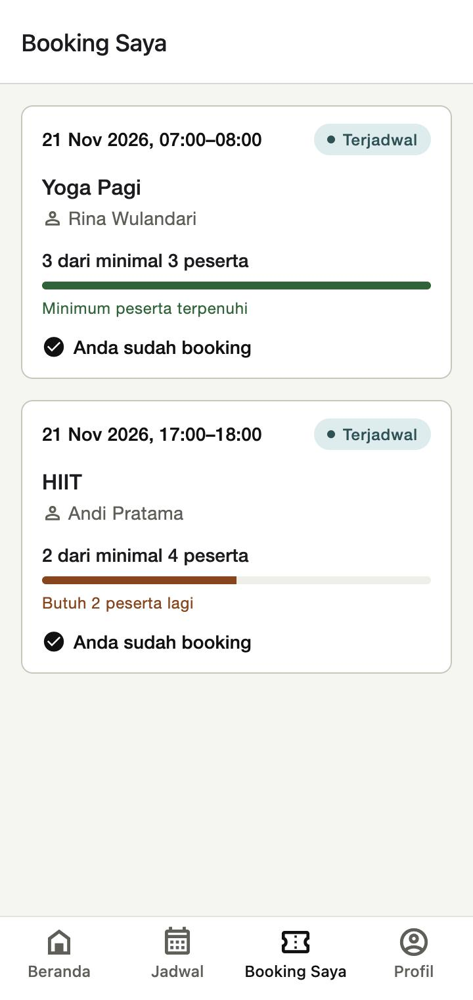</td>
    <td>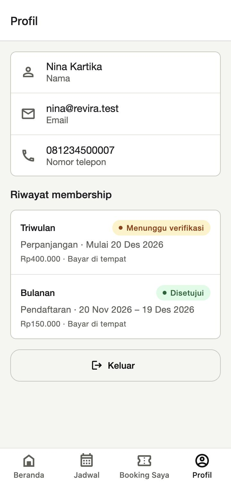</td>
  </tr>
  <tr>
    <td><b>Setelah booking.</b> Counter langsung bertambah dari respons API dan snackbar konfirmasi muncul.</td>
    <td><b>Batalkan booking.</b> Konfirmasi dulu; hanya bisa sebelum sesi dimulai.</td>
    <td><b>Booking saya.</b> Sesi yang dibooking dan belum selesai, urut waktu.</td>
    <td><b>Profil.</b> Data akun dan riwayat membership (disetujui, menunggu, ditolak beserta alasan).</td>
  </tr>
  <tr>
    <td></td>
    <td></td>
    <td>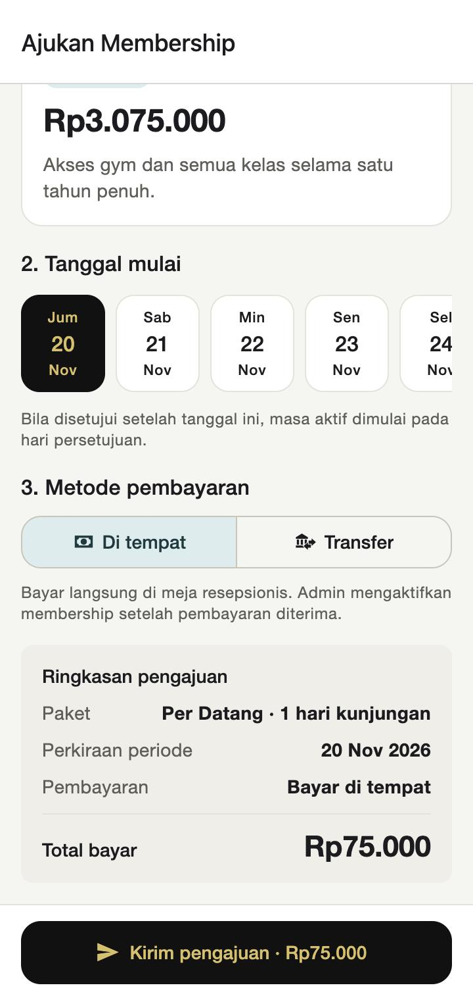</td>
    <td></td>
  </tr>
  <tr>
    <td><b>Paket.</b> Kartu per paket: nama, chip durasi ("1 hari kunjungan", "30 hari"), harga besar (Rp75.000 dst.), dan deskripsi. Kartu muncul bertahap.</td>
    <td><b>Pilih paket.</b> Kartu berperan sebagai radio (terbaca pembaca layar sebagai "Per Datang, 1 hari kunjungan, Rp75.000"); kartu terpilih berlatar emas dengan tanda centang. Tombol kirim ikut menampilkan harga.</td>
    <td><b>Ringkasan pengajuan.</b> Paket dan durasi, perkiraan periode (paket satu hari tampil sebagai satu tanggal), metode bayar, dan total bayar. Ringkasan berganti dengan animasi halus saat pilihan berubah.</td>
    <td><b>Pengajuan terkirim.</b> Menyebut paket dan nominal yang diajukan. Status beranda berubah setelah admin menyetujui.</td>
  </tr>
</table>

### Mode gelap dan responsif

<table>
  <tr>
    <td width="25%"></td>
    <td width="25%"><br /><b>Lebar 412dp.</b> Perpanjangan yang menunggu verifikasi menyembunyikan tombol "Perpanjang".</td>
    <td>
      <ul>
        <li><b>Member app:</b> tema terang/gelap otomatis mengikuti sistem. Tata letak diuji di lebar 360dp dan 412dp; konten dibatasi 560dp agar nyaman di tablet dan web. Target sentuh minimal 48dp.</li>
        <li><b>Admin web:</b> desktop-first dengan sidebar hitam; tabel bergulir di dalam kartunya sendiri bila layar sempit; mode gelap mengikuti sistem.</li>
        <li><b>Gerak:</b> transisi halaman, dialog, menu, kartu, dan perubahan status dibuat singkat (140–260 ms) dan dimatikan otomatis bila sistem meminta <i>kurangi gerakan</i>.</li>
        <li><b>Aksesibilitas:</b> label terhubung ke input (<code>htmlFor</code>/<code>aria-describedby</code>), pesan error dengan <code>role="alert"</code>, tautan "Lewati ke konten utama", fokus keyboard terlihat, dialog dari Radix (focus trap dan tombol Esc), label aksesibilitas pada kartu dan ikon di aplikasi member.</li>
      </ul>
    </td>
  </tr>
</table>

## Arsitektur dan struktur folder

```text
.
├── api/                         Laravel 13 (REST /api/v1)
│   ├── app/Enums                Status sebagai backed enum
│   ├── app/Http/Controllers     Controller tipis (tanpa logika bisnis)
│   ├── app/Http/Requests        Form Request untuk semua validasi
│   ├── app/Http/Resources       API Resource untuk semua respons
│   ├── app/Http/Middleware      EnsureRole (role:admin / role:member), SecurityHeaders
│   ├── app/Services             Logika bisnis: booking, membership, transaksi, jadwal, member, katalog paket, audit
│   ├── config/membership.php    Satu-satunya sumber harga dan durasi paket standar
│   ├── config/security.php      Umur token per peran dan batas permintaan
│   ├── config/cors.php          Origin frontend yang diizinkan
│   ├── app/Casts/DateOnly.php   Kolom tanggal selalu Y-m-d
│   ├── database/                Migrasi, factory, seeder data fiktif
│   ├── docs/openapi.yaml        Kontrak API (OpenAPI 3.1)
│   ├── lang/id                  Pesan validasi bahasa Indonesia
│   └── tests/                   PHPUnit (Feature + Unit)
├── admin-web/                   React + Vite + TypeScript strict
│   └── src/
│       ├── api/                 Fungsi endpoint bertipe
│       ├── auth/                AuthProvider, guard RequireAdmin
│       ├── components/          ui/ (Radix + Tailwind), brand/, layout/
│       ├── domain/              Normalisasi status, progres peserta (dites)
│       ├── features/            members, transactions, schedules, plans, audit, auth
│       ├── hooks/               useApiQuery (abort + reload), useMutation (kunci submit)
│       └── lib/                 http client, format, config, token storage
├── member-app/                  Expo + expo-router + TypeScript strict
│   ├── assets/                  Ikon, favicon, monogram, wordmark
│   └── src/
│       ├── app/                 Rute: login, (tabs)/…, schedules/[id], plans, apply
│       ├── api/  auth/  hooks/  lib/
│       ├── components/          Kartu paket/jadwal/membership, chip status, FadeIn, state views
│       ├── domain/              Aturan booking, normalisasi status, label paket (dites)
│       └── theme.ts             Tema Material 3 dengan palet brand
├── docs/
│   ├── README.md                Indeks dokumentasi
│   ├── SETUP.md                 Panduan menjalankan, variabel lingkungan, skenario E2E
│   ├── screenshots/             Tangkapan layar README
│   └── brand/                   Palet warna
└── .gitignore                   Dependency, env lokal, SQLite, cache/log Laravel, build, cache Expo
```

Prinsip yang dipakai:
- Laravel mengikuti PSR-12 (dicek Pint): Form Request, API Resource, service class, dan middleware peran.
- Frontend memakai TypeScript strict (tanpa `any`), komponen kecil dengan satu tanggung jawab, dan logika dipisah ke hooks/domain.
- Nama kode dalam bahasa Inggris; teks antarmuka dalam bahasa Indonesia.

## Teknologi dan prasyarat

Prasyarat untuk menjalankan:

| Alat | Kebutuhan |
|---|---|
| PHP | ≥ 8.3 (dipakai 8.4) dengan ekstensi `pdo_sqlite`, `sqlite3`, `mbstring`, `openssl` |
| Composer | 2.x |
| Node.js / npm | 22.13+ atau 24 LTS (dipakai 24); Vite 8 butuh ≥ 20.19, Expo SDK 58 butuh ^22.13 atau ^24.3 |
| Expo Go | Versi yang mendukung SDK 58, untuk mencoba di HP |

Versi pustaka yang terpasang:

| Komponen | Versi |
|---|---|
| PHP / Composer | 8.4 / 2.9 |
| Laravel framework / Sanctum | 13.43 / 4.x |
| Database lokal | SQLite (`pdo_sqlite`) |
| Node.js / npm | 24 LTS / 11 |
| React (admin) / Vite / TypeScript | 19.3.1 / 8.3.8 / 6.0.3 |
| Tailwind CSS / Radix UI / React Router | 4.3.5 / 1.8.1 (`radix-ui`) / 8.5.2 |
| Ikon / notifikasi / font | lucide-react 1.77 / sonner 2.0 / Inter & Archivo (Fontsource) |
| Expo SDK / React Native / React (member) | 58.0.26 / 0.88.1 / 19.3.0 |
| expo-router / React Native Paper | 58.0.32 / 5.15.5 |
| Pengujian | PHPUnit 12, Vitest 5.1, Testing Library |
| Zona waktu bisnis | `Asia/Makassar` (WITA), dapat diubah lewat `APP_TIMEZONE` |
| Format respons | `data` (+ `links`/`meta` untuk paginasi); tanggal `YYYY-MM-DD`; jam `HH:MM`; waktu ISO 8601 dengan offset; uang integer rupiah |

## Instalasi dan menjalankan

Ringkasan di [Mulai cepat](#mulai-cepat); detail lengkap di **[docs/SETUP.md](docs/SETUP.md)**.

**File environment** (tidak ada di repositori; buat sendiri, dan sudah diabaikan `.gitignore`):

| File | Variabel wajib | Variabel opsional |
|---|---|---|
| `api/.env` | `APP_ENV` (isi `local`), `APP_KEY`, `SEED_PASSWORD` (untuk seeder) | `APP_NAME`, `APP_DEBUG`, `APP_URL`, `APP_TIMEZONE`, `APP_LOCALE`, `DB_CONNECTION`, `DB_DATABASE`, `CACHE_STORE`, `SESSION_DRIVER`, `QUEUE_CONNECTION`, `LOG_CHANNEL`, `LOG_LEVEL`, `CORS_ALLOWED_ORIGINS`, `ADMIN_TOKEN_TTL_MINUTES`, `MEMBER_TOKEN_TTL_MINUTES`, `SANCTUM_TOKEN_PREFIX`, `SANCTUM_EXPIRATION` |
| `admin-web/.env.local` | `VITE_API_URL` (origin API tanpa `/api/v1`) | |
| `member-app/.env` | `EXPO_PUBLIC_API_URL` (origin API tanpa `/api/v1`; di Expo Go pakai IP komputer) | |

**Migrasi dan seeder**

```bash
cd api
php artisan migrate --seed          # instalasi baru
php artisan migrate                 # memperbarui basis data lama (harga paket ikut diperbarui tanpa menghapus data)
php artisan migrate:fresh --seed    # mengulang dari nol (menghapus semua data lokal)
```

Seeder hanya berjalan bila `APP_ENV` bukan `production` dan `SEED_PASSWORD` terisi; aman dijalankan ulang.

**Akun demo hasil seeder** (data fiktif, domain `.test`). Kata sandinya adalah nilai `SEED_PASSWORD` yang Anda isi sendiri; tidak ada kata sandi yang ditulis di repositori.

| Email | Peran | Kondisi awal |
|---|---|---|
| `admin@revira.test` | admin | Pengelola |
| `budi@revira.test` | member | Aktif (1 Bulan), sudah booking kelas |
| `sari@revira.test` | member | Aktif (3 Bulan) |
| `dewi@revira.test` | member | Kedaluwarsa |
| `rudi@revira.test`, `putri@revira.test` | member | Pengajuan menunggu verifikasi |
| `agus@revira.test` | member | Pengajuan ditolak |
| `nina@revira.test` | member | Belum punya membership |

**Menjalankan aplikasi**

| Aplikasi | Perintah | Alamat bawaan |
|---|---|---|
| API | `php artisan serve` (untuk Expo Go di HP: `php artisan serve --host=0.0.0.0 --port=8000`) | `http://127.0.0.1:8000/api/v1` |
| Admin web | `npm run dev` | `http://localhost:5173` |
| Member app | `npx expo start` (`npm start`); web: `npm run web` atau tekan `w` | Expo Go via QR, web `http://localhost:8081` |

## Perintah pengembangan

Semua perintah di bawah ini didefinisikan di `package.json`/`composer.json` atau bawaan Laravel.

| Folder | Perintah | Fungsi |
|---|---|---|
| `api/` | `php artisan test` (atau `composer test`) | PHPUnit |
| `api/` | `./vendor/bin/pint --test` | Cek gaya kode PSR-12 (tanpa `--test` untuk merapikan) |
| `api/` | `php artisan route:list --path=api` | Daftar route API |
| `admin-web/` | `npm run dev` / `npm run build` / `npm run preview` | Dev server, build produksi ke `dist/`, pratinjau build |
| `admin-web/` | `npm run typecheck` / `npm run lint` / `npm test` | TypeScript strict, ESLint, Vitest |
| `member-app/` | `npm start` / `npm run web` / `npm run android` / `npm run ios` | Expo dev server |
| `member-app/` | `npm run typecheck` / `npm run lint` / `npm test` | TypeScript strict, ESLint, Vitest |

Satu baris per bagian untuk memeriksa semuanya:

```bash
cd api && php artisan test && ./vendor/bin/pint --test
```

```bash
cd admin-web && npm run typecheck && npm run lint && npm test && npm run build
```

```bash
cd member-app && npm run typecheck && npm run lint && npm test
```

Hasil terakhir:

| Bagian | Cakupan | Hasil terakhir |
|---|---|---|
| API (PHPUnit) | Auth (login/me/logout/401/403), paket (CRUD, 404, 409), pengajuan (201, pending ganda, overlap, validasi 422), approval (periode inklusif, geser tanggal lampau, 409), booking (200, 401, 404, 409, 422 untuk sesi batal/dimulai/membership tidak aktif, batal dan booking ulang), daftar member (status, filter paket, pencarian, paginasi), jadwal admin, alur end-to-end, seeder (4 paket dan harganya), unit resolver status, status tampilan sesi, **keamanan** (rate limit login 429, pesan login seragam, umur token per peran dan kedaluwarsa, pembersihan token, header keamanan, CORS, IDOR booking/riwayat, member tanpa nama peserta lain, admin↔member 403, mass assignment, sanitasi HTML, nama paket unik, tanpa hash kata sandi di respons), **audit log** (approve/tolak/ubah harga/ubah status sesi/login admin, tanpa rahasia, tidak tercatat bila aksi gagal, filter, append-only), **katalog harga** (migrasi paket lama tanpa mengubah transaksi dan paket custom, idempoten, urutan dan harga endpoint publik) | **109 tes lulus (476 assertion)**, Pint lulus |
| Admin web (Vitest) | Normalisasi status membership/jadwal/transaksi, aksi jadwal, progres peserta, klien HTTP dan error, format, `useMutation` (kunci submit ganda), `useApiQuery` (menunggu auth, membatalkan request lama, reload, 401), format `Rp75.000`/durasi/periode satu hari, ringkasan log aktivitas | **46 tes lulus**; `tsc` strict, ESLint (0 peringatan), dan build produksi lulus |
| Member app (Vitest) | Aturan booking (aktif pada tanggal sesi, perpanjangan, sesi batal/dimulai, batal booking), normalisasi status, saran tanggal mulai, format tanggal/rupiah (harga paket baru, periode satu hari), label durasi dan label pembaca layar paket, helper HTTP | **33 tes lulus**; `tsc` strict dan ESLint (termasuk aturan React Compiler) lulus |

## Dokumentasi API

Kontrak lengkap: [`api/docs/openapi.yaml`](api/docs/openapi.yaml) (OpenAPI 3.1, 30 operasi, cocok dengan 30 route Laravel). File ini bisa dibuka di penampil OpenAPI apa pun (mis. Swagger Editor atau ekstensi OpenAPI di editor kode); server tidak menyajikan halaman dokumentasi API. Daftar route langsung: `php artisan route:list --path=api`.

Semua endpoint berada di prefix `/api/v1`; endpoint terproteksi memakai header `Authorization: Bearer <token>` dari `POST /login`.

| Metode | Endpoint | Akses | Keterangan |
|---|---|---|---|
| GET | `/health` | Publik | Cek server |
| GET | `/membership-plans` | Publik | Paket aktif |
| POST | `/login` | Publik | Token bearer + `expires_at` (5/menit per akun) |
| POST | `/logout` | Login | Cabut token (204) |
| GET | `/me` | Login | Profil + ringkasan membership (`status`, `is_active`, `has_pending_application`, paket, periode) |
| GET, POST | `/member/memberships` | Member | Riwayat / ajukan (201) |
| GET | `/member/class-schedules?from&to` | Member | Jadwal + `is_booked` |
| GET | `/member/class-schedules/{id}` | Member | Detail sesi |
| POST, DELETE | `/member/class-schedules/{id}/booking` | Member | Booking / batal (mengembalikan jadwal terbaru) |
| GET | `/member/bookings` | Member | Booking yang belum selesai |
| GET, POST, GET, PUT, DELETE | `/admin/membership-plans[/{id}]` | Admin | CRUD paket |
| GET | `/admin/members?status&membership_plan_id&search&page` | Admin | Daftar member + `meta` paginasi |
| GET | `/admin/transactions?status&page` | Admin | Daftar transaksi |
| POST | `/admin/transactions/{id}/approve` · `/reject` | Admin | Setujui / tolak (alasan wajib) |
| GET, POST, GET, PUT, DELETE | `/admin/class-schedules[/{id}]` | Admin | Kelola jadwal |
| PATCH | `/admin/class-schedules/{id}/status` | Admin | Ubah status sesi |
| GET | `/admin/classes`, `/admin/instructors` | Admin | Pilihan form jadwal |
| GET | `/admin/audit-logs?action&page` | Admin | Log aktivitas admin, 20 per halaman |

Contoh respons error:

```jsonc
// 422
{ "message": "Membership Anda tidak aktif pada tanggal sesi ini.", "errors": { "booking": ["Membership Anda tidak aktif pada tanggal sesi ini."] } }
// 409
{ "message": "Anda sudah membooking sesi ini." }
// 401
{ "message": "Unauthenticated." }
// 429 (+ header Retry-After)
{ "message": "Terlalu banyak permintaan. Coba lagi dalam beberapa saat." }
```

## Harga membership

| Paket | Durasi | Harga | Keterangan |
|---|---|---|---|
| Per Datang | 1 hari | Rp75.000 | Akses gym dan kelas untuk satu hari kunjungan |
| 1 Bulan | 30 hari | Rp500.000 | Akses gym dan semua kelas selama 30 hari |
| 3 Bulan | 90 hari | Rp1.050.000 | Akses gym dan semua kelas selama 90 hari |
| 1 Tahun | 365 hari | Rp3.075.000 | Akses gym dan semua kelas selama satu tahun |

**Satu sumber harga.** Harga hanya ditulis di [`api/config/membership.php`](api/config/membership.php). Seeder (dan migrasi untuk basis data lama) menyalinnya ke tabel `membership_plans`. Setelah itu:
- API mengirim `price` dan `duration_days` dari tabel tersebut.
- Admin web dan member app hanya menampilkan nilai dari API. Tidak ada harga yang di-hardcode di frontend.
- Format tampilan sama di kedua aplikasi: `Rp75.000` (tanpa spasi dan tanpa desimal), lewat satu fungsi `formatRupiah` per aplikasi yang dites.
- Admin bisa mengubah harga dari menu Paket Membership; setiap perubahan tercatat di Log Aktivitas dengan nilai lama dan baru.

**Harga tidak dihitung ulang.** Nominal transaksi dicatat saat member mengajukan dan tidak berubah bila harga paket diubah kemudian. Pengajuan lama yang masih menunggu dan nominalnya berbeda dari harga paket saat ini diberi tanda *Harga paket kini …* di halaman Transaksi, sehingga admin bisa memutuskan saat verifikasi pembayaran.

**Instalasi lama.** `php artisan migrate` memperbarui paket Bulanan/Triwulan/Tahunan menjadi 1 Bulan/3 Bulan/1 Tahun dengan harga baru dan menambahkan Per Datang, tanpa menghapus data. Lihat [docs/SETUP.md](docs/SETUP.md#memperbarui-instalasi-lama).

## Keamanan

Prinsipnya *secure by default*: setiap izin diperiksa di server, dan pembatasan di UI hanya untuk kenyamanan.

| Area | Penerapan |
|---|---|
| Autentikasi | Bearer token Sanctum; hanya hash SHA-256 token yang disimpan di basis data. Token berawalan `revira_` (mudah dikenali pemindai rahasia) dan punya masa berlaku per peran: admin 8 jam, member 30 hari. Token kedaluwarsa dihapus saat user login lagi; logout mencabut token yang dipakai |
| Kata sandi | Hash bcrypt (cost 12) lewat cast `hashed`, di-rehash otomatis bila cost berubah. Pesan gagal login sama untuk email tak terdaftar dan kata sandi salah, dan hash tetap dihitung untuk email tak terdaftar supaya keberadaan akun tidak bisa ditebak dari waktu respons |
| Otorisasi (least privilege) | Dua lapis: middleware `role:admin`/`role:member` pada grup route, dan `authorize()` di setiap Form Request admin/member (kelas dasar `AdminRequest`/`MemberRequest`). Admin tidak bisa memakai endpoint member, dan sebaliknya |
| IDOR | Data member selalu diambil dari user pada token (`$request->user()`), tidak pernah dari ID kiriman klien. Membatalkan booking orang lain menghasilkan 404, riwayat membership dan booking hanya milik sendiri, dan detail jadwal untuk member hanya berisi jumlah peserta, bukan nama |
| Mass assignment | Model memakai `$fillable`; service hanya menerima `validated()`. Kolom seperti `status`, `amount`, `user_id`, `role`, `code`, dan `id` yang dikirim klien diabaikan (ada tesnya) |
| Validasi dan sanitasi | Semua input lewat Form Request dengan batas panjang, enum, dan tanggal. Teks bebas (alasan tolak, alasan batal, nama dan deskripsi paket) dibuang tag HTML-nya di server, dan frontend tetap meng-escape keluaran (React) |
| SQL injection | Eloquent/Query Builder dengan parameter terikat; pencarian `LIKE` meng-escape wildcard |
| CSRF | API stateless dengan bearer token, tanpa cookie sesi, sehingga tidak rentan CSRF. CORS hanya mengizinkan origin di `CORS_ALLOWED_ORIGINS`, tanpa credentials |
| Rate limit | Login per akun + IP dan per IP, pengajuan/booking per member, dan semua endpoint lain per user/IP. Lihat [`config/security.php`](api/config/security.php) |
| Header respons | `X-Content-Type-Options: nosniff`, `X-Frame-Options: DENY`, `Content-Security-Policy: default-src 'none'`, `Referrer-Policy: no-referrer`, `Permissions-Policy`, `Cache-Control: no-store, private` (data pribadi tidak di-cache), dan HSTS bila diakses lewat HTTPS |
| Integritas data | Foreign key `restrict` (riwayat tidak bisa terhapus berantai), UNIQUE booking per sesi dan member, UNIQUE kode paket (nama paket unik lewat validasi), transaksi database dengan `lockForUpdate` untuk approval dan booking. Aksi admin dan catatan auditnya disimpan dalam satu transaksi |
| Audit log | Tabel `audit_logs` append-only (model menolak update/delete): pelaku, aksi, objek, detail, IP, dan waktu. Kunci rahasia (`password`, `token`, dll.) disaring sebelum disimpan, dan IP tidak dikirim ke frontend |
| Error | Respons error hanya berisi pesan dan kesalahan per kolom. Detail internal hanya muncul bila `APP_DEBUG=true`, yang wajib `false` di server |
| Rahasia | Tidak ada kredensial, token, atau `.env` di repositori. Kata sandi seeder dibaca dari `SEED_PASSWORD`; seeder menolak berjalan bila kosong atau di `production` |
| Data pribadi | Yang disimpan hanya nama, email, telepon, dan riwayat membership. Tidak ada data kartu atau rekening; pembayaran diverifikasi manual oleh admin |

**Risiko yang masih tersisa** (butuh perubahan infrastruktur atau keputusan bisnis):
- **Token di `localStorage` (admin web dan member app versi web).** Bila suatu saat ada celah XSS, token bisa dicuri. Mitigasi saat ini: masa berlaku token (admin 8 jam), tidak ada HTML dari pengguna yang dirender, dan teks dibersihkan di server. Perbaikan tuntas: autentikasi SPA berbasis cookie `HttpOnly` + CSRF Sanctum dengan domain yang sama, serta Content Security Policy di hosting frontend.
- **Tidak ada HTTPS di lingkungan lokal.** Saat di-hosting, API dan frontend wajib di belakang TLS; HSTS otomatis aktif bila request lewat HTTPS. Bila API di belakang reverse proxy, konfigurasi *trusted proxies* agar IP untuk rate limit dan audit log benar.
- **Rate limit memakai cache aplikasi.** Bawaannya tabel `cache` di SQLite; pada beberapa server sekaligus perlu cache bersama (Redis) agar batasnya konsisten.
- **Belum ada MFA, kebijakan ganti kata sandi, atau penguncian akun permanen** untuk admin. Rate limit hanya memperlambat tebakan.
- **Audit log bisa dihapus lewat akses langsung ke basis data.** Untuk jejak yang benar-benar tahan ubah, kirim log ke penyimpanan terpisah (mis. log server terpusat).
- **Pembersihan token kedaluwarsa** baru terjadi saat user login lagi. Di server, jadwalkan `php artisan sanctum:prune-expired` lewat scheduler/cron.
- **Tidak ada upload file**, jadi belum ada risiko di area itu; bila bukti transfer ditambahkan, perlu validasi MIME, batas ukuran, dan penyimpanan privat.
- Keamanan sistem ini **tidak sempurna**. Tes otomatis mencakup skenario di atas, tetapi belum ada uji penetrasi atau audit pihak ketiga.

## Aturan bisnis

| Aturan | Hasil |
|---|---|
| Booking hanya untuk sesi berstatus `scheduled` yang belum dimulai | Selain itu **422** (`errors.booking`) |
| Member harus aktif pada **tanggal sesi** (`active` dan `start_date ≤ tanggal ≤ end_date`) | Bila tidak, **422** "Membership Anda tidak aktif pada tanggal sesi ini." |
| Booking ganda pada sesi yang sama | **409** "Anda sudah membooking sesi ini." |
| Kapasitas kelas | Hanya `min_participants`, **tanpa batas maksimum** (keputusan referensi). Karena itu status "penuh" tidak ada |
| Pembatalan booking | Hanya sebelum sesi dimulai; booking bisa diulang (baris lama diaktifkan kembali) |
| Pengajuan membership | Ditolak 422 bila masih ada pengajuan *pending* atau periode bertabrakan dengan membership aktif |
| Persetujuan transaksi | 409 bila sudah diproses atau periode bertabrakan dengan membership aktif lain |
| Validasi gagal / tanpa token / peran salah | **422** / **401** / **403** |
| Batas permintaan | Login 5/menit per akun + IP dan 20/menit per IP; pengajuan dan booking 20/menit per member; endpoint lain 120/menit. Selebihnya **429** dengan header `Retry-After` |

## Skema database

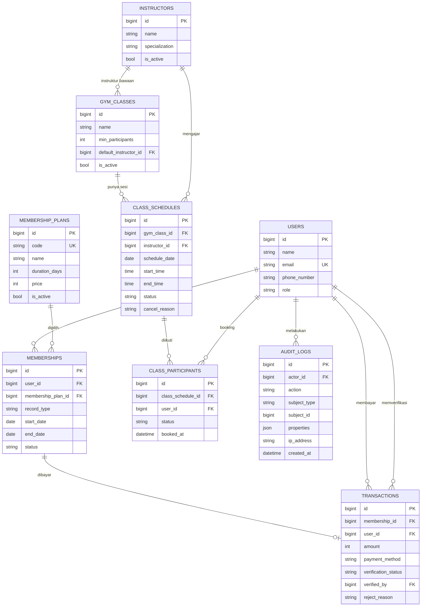

Catatan desain skema:
- **Riwayat, bukan overwrite.** Setiap pengajuan atau perpanjangan adalah baris baru di `memberships`.
- **Status membership:** `pending`, `active`, `expired`, atau `rejected`. Status `upcoming` dan `none` diturunkan saat dibaca.
- **Booking:** `class_participants` memiliki UNIQUE `(class_schedule_id, user_id)`. Pembatalan mengubah status, tidak menghapus baris.
- **Jumlah peserta** dihitung langsung dari booking yang tidak dibatalkan, tanpa kolom counter yang bisa tidak sinkron.
- **Tidak ada kolom kapasitas maksimum** di tabel kelas.
- **`membership_plans.code`** (`per_visit`, `monthly`, `quarterly`, `yearly`) mengenali paket standar walau admin mengganti namanya. Paket buatan admin tidak punya kode.
- **`transactions.amount`** menyimpan harga saat pengajuan, terpisah dari `membership_plans.price`.
- **`audit_logs`** hanya ditambah; `actor_id` menjadi `NULL` bila user dihapus agar catatannya tetap ada.

## UI/UX dan animasi

| Area | Perubahan |
|---|---|
| Pemilihan paket (member) | Kartu paket dengan chip durasi, harga besar, dan deskripsi. Di formulir, kartu menjadi pilihan radio yang jelas (latar emas + centang), dengan efek tekan ringan |
| Ringkasan dan feedback | Ringkasan pengajuan menampilkan paket, durasi, periode, metode bayar, dan **total bayar**; tombol kirim menyebut harga ("Kirim pengajuan · Rp500.000") atau meminta memilih paket dulu. Layar sukses menyebut paket dan nominal |
| Status | Chip status di member app dan badge status di admin "berdenyut" sekali saat nilainya berubah (mis. setelah booking atau persetujuan), sehingga perubahan terlihat tanpa mengganggu |
| Transisi | Halaman admin muncul dengan fade + geser 6px (220 ms); dialog, dropdown, dan select membesar halus dari titik asalnya; baris tabel dan kartu daftar muncul memudar bertahap; tombol mengecil sedikit saat ditekan |
| State kosong dan error | Ikon dalam lingkaran, judul, penjelasan, dan aksi (mis. *Cari kelas* di beranda bila belum ada booking). Pesan error formulir muncul dengan animasi dan `role="alert"` |
| Formulir admin | Pratinjau harga ("Tampil sebagai Rp500.000") dan petunjuk durasi ("1 = per datang, 30 = 1 bulan") |
| Harga | Format seragam `Rp75.000` di kedua aplikasi; periode satu hari tampil sebagai satu tanggal |
| Navigasi admin | Menu *Log Aktivitas* baru; padding konten lebih rapat di layar kecil |
| Performa | Animasi hanya memakai `opacity`/`transform` (native driver di Android/iOS), durasi 140–260 ms, dan tidak pernah menghalangi sentuhan atau klik |
| Kurangi gerakan | Admin web: aturan global `prefers-reduced-motion` mematikan semua animasi dan transisi. Member app: `AccessibilityInfo.isReduceMotionEnabled` (web: `prefers-reduced-motion`) membuat konten langsung tampil tanpa animasi |

## Identitas visual

Palet dan tipografi mengikuti brand board **Revira Fitness Center**.

<p align="center">
  
</p>

| Elemen | Penerapan |
|---|---|
| **Gold `#D9BF63`** | Tombol utama admin (teks hitam di atas emas), nama paket di kartu membership, menu aktif sidebar, warna utama tema gelap |
| **Teal `#4C969B`** | Tulisan "FITNESS CENTER", status *Terjadwal*/info, cincin fokus keyboard |
| **Black `#000000`** | Sidebar admin, monogram, kartu membership, tombol utama member di tema terang (teks emas) |
| Monogram "R" | Ikon aplikasi, favicon, logo di login dan sidebar ([`member-app/assets/brand/mark.png`](member-app/assets/brand/mark.png)) |
| Wordmark | "REVIRA" memakai Archivo (lebar 125%, tebal 800); "FITNESS CENTER" teal dengan jarak huruf lebar |

Catatan aksesibilitas warna: emas dan teal asli kontrasnya rendah sebagai teks di atas putih (sekitar 1,8:1 dan 3,4:1). Karena itu:
- Di tema terang, emas dipakai sebagai latar atau di atas hitam, dan teks sekunder memakai teal yang digelapkan (`#2F6E73`, sekitar 5,9:1).
- Di tema gelap, emas menjadi warna utama.
- Warna status (hijau, kuning, merah) tetap semantik supaya maknanya tidak tertukar.

> **Logo ilustrasi** (siluet atlet pada brand board) tidak tersedia sebagai file, sehingga tidak disertakan dan tidak digambar ulang. Monogram dan wordmark di aplikasi dibuat ulang dari font Archivo mengikuti brand board. Bila file logo asli tersedia, ganti aset di [`member-app/assets/brand/`](member-app/assets/brand) dan komponen [`BrandMark`](admin-web/src/components/brand/BrandMark.tsx)/[`BrandWordmark`](admin-web/src/components/brand/BrandWordmark.tsx).

## Troubleshooting

| Gejala | Penyebab dan solusi |
|---|---|
| Seeder berhenti dengan pesan "tidak boleh dijalankan di production" | `APP_ENV` kosong dianggap `production`. Isi `APP_ENV=local` di `api/.env` |
| Seeder berhenti dengan pesan "SEED_PASSWORD belum diisi" | Isi `SEED_PASSWORD` di `api/.env`, lalu jalankan ulang `php artisan db:seed` |
| `php artisan migrate` melaporkan file database SQLite tidak ada | Buat filenya dengan `touch database/database.sqlite` (atau jawab *yes* saat Laravel menawarkan membuatnya), atau atur `DB_DATABASE` |
| Admin web atau member app menampilkan "Alamat API belum diatur" | `VITE_API_URL` / `EXPO_PUBLIC_API_URL` kosong. Isi, lalu **hentikan dan jalankan ulang** dev server (nilai env dibaca saat start) |
| Browser menolak request karena CORS | Origin frontend tidak ada di `CORS_ALLOWED_ORIGINS`. Bawaannya hanya `localhost`/`127.0.0.1` port 5173 dan 8081; tambahkan origin lain (dipisah koma) bila memakai port atau domain berbeda |
| Expo Go di HP tidak bisa terhubung ke API | `localhost` di HP menunjuk ke HP itu sendiri. Pakai IP komputer di `EXPO_PUBLIC_API_URL`, jalankan API dengan `--host=0.0.0.0`, dan pastikan HP satu jaringan Wi-Fi |
| Tiba-tiba kembali ke layar login | Token kedaluwarsa (admin 8 jam, member 30 hari) atau sudah logout. Masuk kembali |
| Login ditolak "Terlalu banyak permintaan" (429) | Lebih dari 5 percobaan per menit untuk akun yang sama. Tunggu sesuai header `Retry-After` |
| Harga paket masih harga lama | Basis data dibuat sebelum pembaruan harga. Jalankan `php artisan migrate` |
| `composer setup` atau `composer dev` gagal | Keduanya script bawaan scaffold Laravel yang butuh `.env.example` dan `package.json` di `api/`, dan keduanya tidak ada di proyek ini. Ikuti langkah manual di atas |

## Hasil analisis

Proses pengembangan, keputusan desain, riset UI, dan temuan uji.

<details>
<summary>Buka hasil analisis</summary>

### 1. Analisis repositori referensi

Referensi `Revira-gym-project-v2` dipelajari, tanpa menyalin kode: README, ERD, kontrak OpenAPI, migrasi, model, service, seeder, tes, dan layar admin/member. Yang diadopsi sebagai aturan bisnis:
- Satu tabel `users` dengan peran.
- Pemisahan `memberships` (periode) dan `transactions` (pembayaran), dengan riwayat sebagai baris baru.
- Tidak ada kapasitas maksimum kelas.
- Definisi "member aktif pada tanggal sesi".
- Prioritas status member.
- Kunci baris (`lockForUpdate`) untuk booking dan approval.
- Konvensi format respons (tanggal, jam, uang).

Yang sengaja **tidak** dibawa karena di luar lingkup permintaan atau terkait deploy:
- Gateway WhatsApp (Fonnte).
- Upload bukti transfer.
- Jam operasional.
- CRUD instruktur dan kelas (cukup data seeder dan endpoint baca).
- Registrasi mandiri.
- Docker/Railway.
- Workflow CI.
- MySQL (diganti SQLite lokal).

### 2. Keputusan desain

| Keputusan | Alasan |
|---|---|
| `end_date` inklusif (`start + durasi − 1`) | Mengikuti referensi; paket 30 hari mulai 20 Nov berakhir 19 Des |
| Status "penuh" dihapus | Tanpa kapasitas maksimum, API tidak pernah menghasilkannya; badge "penuh" hanya akan menjadi kode mati |
| Tanpa upload bukti transfer | Tidak diminta; metode bayar tetap dicatat dan admin memverifikasi manual |
| Status `upcoming` ditambahkan | Membership yang disetujui tetapi belum mulai tidak salah tampil sebagai "none" atau "expired" |
| Membership penentu = id terbesar per kategori | Paket di daftar member dan filter `membership_plan_id` dijamin konsisten (subquery yang sama dengan resolver PHP) |
| Cast `DateOnly` | Cast `date` bawaan menyimpan `Y-m-d 00:00:00` di SQLite sehingga pencocokan tanggal persis gagal |
| `has_pending_application` di `/me` | Perpanjangan yang menunggu verifikasi tetap terlihat walau status terkini `active` |
| Status tampilan dihitung dari jam | Admin tidak selalu mengubah status tepat waktu; sesi yang lewat jam mulai/selesai tetap tampil benar |

### 3. Riset framework UI

**Admin web.** Perbandingan komunitas 2026 paling konsisten merekomendasikan shadcn/ui di atas Radix untuk aksesibilitas (WAI-ARIA) dan kontrol penuh atas kode, dan stack ini cocok dengan Vite + Tailwind. MUI dan Mantine lebih berat dan memakai sistem styling sendiri. Radix dipilih alih-alih Base UI karena lebih matang (konservatif).

**Member app.** NativeWind stabil (4.2.7) masih untuk Tailwind v3 dan baru terverifikasi sampai Expo SDK 57; v5 untuk Tailwind v4 masih RC. Untuk Expo Go SDK 58 itu berisiko. React Native Paper (Material 3) dipilih karena matang, peer dependency longgar, berjalan di Expo Go, dan aksesibel.

Sumber:
- [shadcn/ui vs MUI vs Ant Design](https://adminlte.io/blog/shadcn-ui-vs-mui-vs-ant-design/)
- [Shadcn Alternatives 2026](https://designrevision.com/alternatives/shadcn)
- [Dokumentasi shadcn/ui untuk Vite](https://ui.shadcn.com/docs/installation/vite)
- [NativeWind v5 migration guide](https://www.nativewind.dev/v5/guides/migrate-from-v4)
- [LogRocket: React Native UI libraries](https://blog.logrocket.com/best-react-native-ui-component-libraries/)

### 4. Temuan uji end-to-end dan perbaikannya

Uji dijalankan pada API asli (`php artisan serve` + SQLite), admin web (Vite), dan member app versi web (Expo), di lebar 1280px, 360dp, dan 412dp, dalam mode terang dan gelap. Alur ajukan → setujui → daftar member → booking → counter → peserta di admin berhasil. Masalah yang ditemukan lalu diperbaiki:

| Temuan | Perbaikan |
|---|---|
| Request tanpa token **dan** tanpa header `Accept: application/json` menghasilkan 500 ("Route [login] not defined") | Tamu tidak lagi diarahkan ke halaman login (`redirectGuestsTo`); kini selalu 401 JSON, dengan tes regresi |
| Label tab bar member terpotong (label 12px di tab bar 48px) | Tinggi tab bar mengikuti safe-area inset |
| `ProgressBar` Paper di web memakai `height: 100%` sehingga teks "Butuh N peserta lagi" keluar dari kartu | Progress bar dibungkus wadah setinggi 6px |
| Banner "membership tidak aktif" masih muncul setelah admin menyetujui | Profil dimuat ulang setiap layar Jadwal/Paket difokuskan |
| Snackbar menutupi tombol "Batalkan booking" | Snackbar diposisikan di atas footer aksi |
| Field login member tanpa nama aksesibel di web | `accessibilityLabel` ditambahkan |
| Warna elevation bawaan MD3 bernuansa ungu (dialog) | Diganti netral sesuai palet brand |
| Tombol "Perpanjang" tetap muncul saat perpanjangan masih pending | `/me` mengirim `has_pending_application`, dan aplikasi menyembunyikan tombol |
| Tabel transaksi admin melebar melewati layar | Kolom grid `minmax(0,1fr)` dan padding sel lebih rapat |

Putaran kedua (pembaruan UI/UX, harga, dan keamanan), dijalankan pada basis data demo yang masih berisi harga lama:

| Temuan | Perbaikan |
|---|---|
| Format harga berbeda: admin `Rp 150.000` (dengan spasi), member `Rp150.000` | `formatRupiah` admin diseragamkan menjadi `Rp75.000`, dengan tes |
| Harga paket ditulis di seeder dan tidak bisa diperbarui di basis data yang sudah ada | Katalog dipindah ke `config/membership.php`; migrasi memperbarui paket lama di tempat. Diverifikasi: 3 paket lama diperbarui, Per Datang ditambahkan, 6 transaksi lama (total Rp1.400.000) tidak berubah |
| Pengajuan pending lama tetap bernominal harga lama tanpa penjelasan | Halaman Transaksi menampilkan *Harga paket kini …* di bawah nominal |
| Paket Per Datang tampil "20 Nov 2026 – 20 Nov 2026" | Periode satu hari ditampilkan sebagai satu tanggal |
| Garis bawah filter Log Aktivitas hanya selebar kotak filter | Pembatas dibuat selebar kartu |

Alur ajukan paket 1 Bulan (Rp500.000) → admin setujui → toast periode → catatan *Transaksi disetujui* di Log Aktivitas berhasil di browser. Header keamanan, CORS (origin asing tidak mendapat `Access-Control-Allow-Origin`), dan 401 tanpa token diperiksa langsung ke server yang berjalan.

Kasus negatif pada API live:

| Kasus | Hasil |
|---|---|
| Booking ganda | 409 |
| Booking sesi dibatalkan | 422 |
| Member tanpa membership aktif | 422 |
| Tanpa token | 401 |
| Pengajuan tanggal lampau + metode salah | 422, dua error per kolom |
| Member ke endpoint admin | 403 |

### 5. Keamanan dan privasi

Rincian penerapan dan risiko yang tersisa ada di bagian [Keamanan](#keamanan). Di sisi klien, tombol dikunci selama request dan request lama dibatalkan. Token admin disimpan di `localStorage`; token member di `expo-secure-store` (native) dan `localStorage` (web).

</details>

## Keterbatasan dan tindak lanjut

**Belum diverifikasi**
- Aplikasi member belum diuji di HP fisik lewat Expo Go maupun build native Android/iOS. Pengujian visual dilakukan pada versi web Expo dengan emulasi 360dp dan 412dp.
- `npx @redocly/cli lint` tidak dijalankan karena izin mengunduh alat ditolak saat pengembangan. Sebagai gantinya, skrip lokal memastikan semua `$ref` OpenAPI valid dan 30 operasi cocok dengan 30 route Laravel.
- Animasi dengan *kurangi gerakan* aktif diperiksa lewat kode (aturan CSS dan `AccessibilityInfo`), belum diuji dengan pengaturan sistem yang benar-benar dinyalakan.
- Screenshot admin nomor 03, 07–11, dan 14 diambil sebelum menu *Log Aktivitas* ditambahkan, sehingga sidebarnya belum memuat menu tersebut. Isi halamannya tidak berubah.

**Keterbatasan fungsional**
- Logo ilustrasi brand belum disertakan karena filenya tidak tersedia.
- Pemeriksaan "sesi sudah dimulai" di aplikasi member memakai jam perangkat. API tetap menjadi penentu akhir dengan zona `APP_TIMEZONE`.
- Status `expired` tersimpan tidak diubah oleh job terjadwal. Status terkini dihitung dari tanggal saat dibaca, sehingga hasilnya tetap benar.

**Rekomendasi sebelum produksi**
- Ganti SQLite dengan MySQL/PostgreSQL dan Redis untuk cache rate limit.
- Isi `CORS_ALLOWED_ORIGINS` dengan domain frontend asli dan pasang HTTPS.
- Jadwalkan `sanctum:prune-expired`.
- Pertimbangkan autentikasi cookie `HttpOnly` untuk admin web dan MFA untuk admin.
- Tambahkan upload bukti transfer dan notifikasi WhatsApp bila dibutuhkan.
- Siapkan build EAS untuk Android/iOS.
